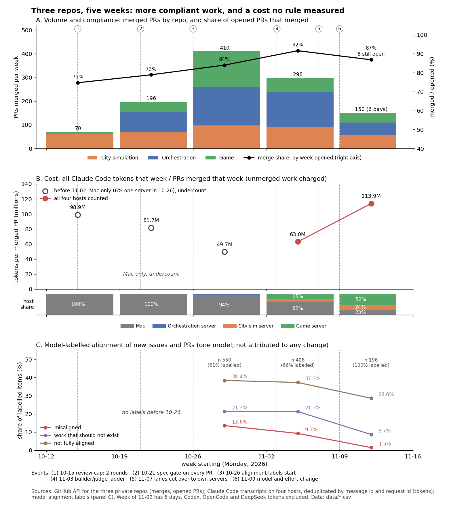
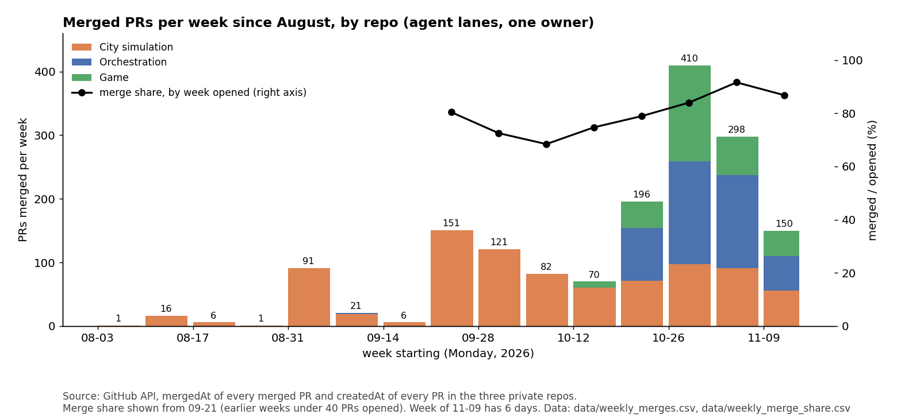

# Data and method

The README tells the 2D to 3D story; this file holds how every number was computed, the full results and judge check tables, and the fleet detail that used to sit in the README. Every fleet number in this repo comes from one of four sources, each read without writing to it. The 3D lead case numbers come from the game repo's experiment issue (#727) and are described in section 5. The three source repositories are private, so this repo carries aggregates only: no PR titles, no transcript text, no account identifiers. Weeks start Monday UTC. The latest week, starting 2026-11-09, has six days (data cut 2026-11-14).

## 1. GitHub: merges, opened PRs, merge share

- **Query:** `gh pr list --state all --limit 5000 --json number,createdAt,mergedAt,state` for each of the three repos, read-only. The data was cut on 2026-11-14.
- **Rerun check:** the same query was run again on 2026-11-15 and the weekly counts recomputed. Every weekly merge count from 2026-08-03 through the week of 11-02, and every merge share from 09-21 through 11-02, came out identical to the CSVs. Only the week of 11-09 has moved since the cut (150 merges then, 151 on the rerun). The CSVs keep the 11-14 cut, because the token figures use the same cut.
- **Merged PRs per week** (`data/weekly_merges.csv`): count of PRs by the week of `mergedAt`, per repo, 2026-08-03 to 2026-11-14.
- **Merge share** (`data/weekly_merge_share.csv`): PRs merged divided by PRs opened, by the week of `createdAt`, all repos pooled. PRs still open at the cut count as not merged. The latest week is provisional, not a lower bound: it was 132 of 152 (86.8%, 8 open) at the cut and 133 of 159 (83.6%) on the 11-15 rerun, because PRs opened late in a week have had no time to merge. Shown from 2026-09-21; earlier weeks have under 40 PRs opened.
- **Scale line in the README:** 1,213 PRs merged from 2026-10-17 to 11-16 across 18 repos, from a per-repo tally made on 2026-11-16 (the exact query was not kept with it): orchestration 488, city simulation 389, game 313, the other 15 repos 23 together. The three main repos hold 1,190, 98%. This is a later and wider window than the two below.
- **Two windows, kept separate:** 1,118 PRs merged from 2026-10-14 to 11-14 (the one-month volume figure); 1,124 PRs merged in the weeks starting 10-12 through 11-09 (the denominator for tokens per merged PR).
- **Spec citation:** PR bodies parsed for a `## Spec` section citing spec lines. City simulation, by week from 10-14: 0 of 101, 8 of 107, 89 of 89, 105 of 105, 42 of 46. Game, by week from 10-21: 0 of 22, 53 of 98, 149 of 149, 86 of 86, 14 of 14. Orchestration: 392 of 493 over the month.
- **Judge rejection rate:** rulings parsed from review bodies of the form `Ruling: MERGE | CHANGES | HOLD`; the rate is rulings other than MERGE over all rulings. These weeks start on Wednesday 10-14, unlike the Monday weeks used everywhere else, so they are given here and not as a CSV.

  | Week starting | City simulation | Game | Orchestration |
  |---|---|---|---|
  | 10-14 | 0.24 | no rulings | no rulings |
  | 10-21 | 0.31 | 0.47 | 0.40 |
  | 10-28 | 0.21 | 0.39 | 0.38 |
  | 11-04 | 0.18 | 0.37 | 0.61 |
  | 11-11 (4 days) | 0.50 | 0.68 | 0.51 |

  The jump in the last four days follows the 11-09 model change. Whether it is a stricter judge or worse work has not been established. A HOLD is sometimes a request for more evidence, not a spec miss.

## 2. Claude Code transcripts: tokens

- **Files:** every Claude Code transcript (`*.jsonl`) on the Mac (about 3,330 files) and the three servers (about 5,065, 5,200 and 968 files), read in place.
- **Counting:** each assistant message's `usage` block (input, output, cache write, cache read). Retries and resumed sessions repeat messages, so usage is deduplicated by the pair (message id, request id) before summing.
- **Tokens per merged PR** (`data/weekly_tokens_by_host.csv`): all tokens counted in a week divided by PRs merged that week. Unmerged and abandoned work stays in the numerator on purpose: it is part of what merged work cost. Over the weeks 10-12 to 11-09 this is 79.2B tokens over 1,124 merges, 70.4M per merged PR (1.27M non-cache, 163K output).
- **Composition:** cache reads are 97.9% to 98.5% of tokens in every week (98.2% overall); output is 0.07% to 0.45%.
- **Why it is a floor:**
  - Server transcripts before 2026-11-02 are absent, except one week (10-26) on the orchestration server. Agent lanes did run on the servers before then, so the weeks of 10-12, 10-19 and 10-26 are undercounts of unknown size. The figure draws them hollow and does not join them to later weeks. No trend across 11-02 can be claimed in either direction.
  - Codex, OpenCode and the DeepSeek first pass are excluded.
  - Transcripts before about 10-08 lack usage blocks, so there is no September baseline.
- **Not used:** an earlier Mac-only table that suggested tokens per merge were falling. That fall was an artifact of server lanes not being counted, and it is withdrawn.
- **Per-repo cost:** not reported. Attribution by working directory left 29% to 79% of tokens unassigned. Host share is a rough proxy only from the 11-07 cutover, when each repo's lanes moved onto its own server.

## 3. Fleet database: alignment labels, rulings, utilization (read-only)

- **Alignment labels** (`data/weekly_alignment_labels.csv`): since 2026-10-26 one frontier model labels new issues and PRs against their repo's spec as written at the time; since 2026-11-09 also against the owner's prompts. It labelled 550 of 906 items created in the first week, 408 of 616 in the second and 196 of 196 in the third. Categories: misaligned (works against the spec), trash (work that should not exist), and unaligned (anything not fully aligned, a superset of the other two). Shares are of labelled items. The CSV holds the weekly summary figures, not label rows.
- **Auto-filer:** a second column set excludes items filed by an automatic ledger filer, which was paused during the window. Without those items the misaligned share is 13.6%, 7.4% and 0.6% (n 523, 350, 179) and the trash share 18.4%, 12.6% and 1.7%. So removing the filer's own items does not remove the fall. The pause may still have had indirect effects, and the rubric and model changes remain.
- **Owner-prompt labels:** of 192 items labelled against the owner's prompts from 11-09, 125 serve a prompt, 26 serve one in part, 26 are in the spec but unprompted, 13 are unclear and 2 work against a prompt.
- **Alignment monitor:** AUC 0.651 of the live 13-weight logistic monitor against the model labels (358 items); its guard caught 0 of 63 items labelled trash.
- **Labeler agreement:** kappa 0.755 on 50 items labelled twice by the same model. This measures consistency, not validity.
- **Weight-model candidates:** 7 proposed by the proposer harness since 2026-11-13; none beat the live baseline on a time-split held-out set, so none was adopted. That adoption bar is part of the harness design.
- **Utilization** (`data/host_utilization_7d.csv`): CPU sampled every 5 minutes per host, and idle or under-used flags raised by the capacity monitor, 2026-11-07 to 11-14. The CSV holds the summary figures of the utilization report, not sample rows.

## 4. Incident records

The eight cases in `incidents/` come from dated notes the agents wrote after each owner correction (213 such notes, 80 with the owner's words quoted). Owner quotes are paraphrased as the rule they state. A separate audit found 48 correction markers in 14 days (25 repeated orders, 9 uses of a banned language, 5 false "done" claims), and a week audit found 28 verified corrections against 8 rows in the corrections table, so the logged corrections undercount.

## 5. Lead case: 3D builds with no person watching

All of these come from comments on the game repo's experiment issue (#727, private), each cited by comment id, and from the score tables those comments link. Every 3D score is **judge only, not validated**: it comes from one fresh Opus medium scorer per round, and that scorer has not been checked against the owner.

### What was compared

- **Old standard:** the first pipeline's best build of the standard chassis, frozen at commit d9c0ea79 after 74 rounds (70 on single parts, 4 whole-body passes). It was built part by part against per-part reference images, with Opus at medium effort and Fable per part. It has one body with no sex.
- **New method:** the same chassis rebuilt twice, a female body and a male body, 12 judge-builder rounds each: two phases (shape, then texture), two passes per phase (Opus high, then Fable high), three rounds per pass (one per view). Each round a fresh judge session reviews the build from one view (front, profile or back, in turn) against the owner-approved whole-body shape and texture art, then the same session fixes what it found; there is no handoff to a separate builder. A separate fresh scorer then scores the round at all three views. Builders were Opus at high effort, then Fable at high effort. The scoring rubric, from the #727 issue body, is the same for old and new: 0 to 100 per body part, 40 points shape and proportion, 30 detail, 30 material and colour. Final builds: female 6ec7429d, male f671f540.

### How each number was computed

| Number | How | Source |
|---|---|---|
| Agent wall hours per body: old 97.1, new 8.3 (female) and 10.0 (male) | Sum of lane wall clock per round, build sessions. The new scorer sessions add 0.86 (female) and 0.93 (male) hours and are not in these figures. The old figure includes waits on account limits | old: baseline cost table on #727; new: lane durations on the game server |
| Build cost per body: old 747.82 USD, new 182.00 (female) and 160.67 (male) USD | Sum of list-price cost, last result event per session id (the same method as the old baseline) | comments 6903328205 (old) and 6924712566 (new, corrected: the first posting 6915289250 counted some resumed sessions twice) |
| Scorer cost: about 24 USD per body | Same method, scorer rounds only. An earlier figure of 334 USD double-counted resumed sessions and is withdrawn | scorer transcripts |
| Cost ratio about 4x on build, 3.6x to 4.0x with scorer | 747.82 / 182.00 = 4.1 and 747.82 / 160.67 = 4.7 build only; 747.82 / 206.45 = 3.6 and 747.82 / 185.13 = 4.0 with scorer (24.45 and 24.46). The old figure already contains its own scoring | 6924712566 |
| Cost per round by pass, and the 189 USD projection | Mean, SD and range over every finished new round (41 build, 36 scorer) in the per-round cost table droid-cost-allchassis.csv (525 rows, old rounds included; 21 of 448 old rounds carry estimated cost, 180.84 USD, flagged). Projection = 3 x (9.79 + 21.44 + 6.11 + 17.53) + 24 | AlexNet lane, 2026-11-16, recomputed here from the CSV |
| Self minus fresh score | Mean and SD of builder self-score minus fresh scorer over the 33 rounds that have both (dx-gaming-gap) | AlexNet lane, 2026-11-16 |
| Part regions vs the whole-body texture art: old 46.6, new 70.6 and 69.8 | Mean over the same 11 part rows, three views, of the final scorer's 0 to 100 scores against the approved texture art | comments 6904021106 (old), 6913124415 (female), 6915255579 (male); confirmed against the final scorers' score tables on 2026-11-16 |
| Parts vs the old pipeline's own per-part references: old 54.9, new 59.9 and 60.9 | Mean over the same 11 part rows against the per-part references the old pipeline was built from | same |
| Acceptable as is for the next step: female 20 of 24 rows, male 16 of 25 | The scorer's yes or no per part and target row. Not asked of the old build | comment 6915289250 |
| Builder self-score against a fresh scorer | Two cited rounds, both Fable texture round 2: female self 58 to 67 on profile, fresh scorer 73.3 flat; male self 61 to 72 on profile, fresh scorer's profile score 76 to 70 | comment 6915289250 |

The old build has no whole-chassis score, so only the two part-mean measures above are compared.

- **Old pipeline across six chassis:** 4,004.72 USD, 448 rounds and 519.5 agent hours in total; per chassis (one body each): standard 747.79 USD, 97.1 h, 74 rounds; lean 583.52, 72.8, 62; angular 706.25, 91.4, 93; minimal 577.13, 75.6, 65; carbon standard 678.62, 91.6, 81; reinforced angular 711.41, 91.0, 73. Summed from the old rows of droid-cost-allchassis.csv (the standard row there is 747.79 against 747.82 on #727, a rounding difference between the two tallies).

### Full results table

Rows 1 to 5 are one chassis (the standard chassis): one old build, frozen after 74 rounds, against a female and a male new body, 12 rounds each. Row 6 covers every round so far that has both scores, on the standard and lean chassis. Every 3D score is from one fresh Opus medium scorer per round.

| # | Result | Old pipeline | New method | n | Caveat |
|---|---|---|---|---|---|
| 1 | Agent wall hours per body | 97.1 | 8.3 (female), 10.0 (male) | 1 old build, 2 new bodies | About 10 to 12x faster on build sessions; the fresh scorer adds about 0.9 hours per body (9 to 11x with it). The old hours include waits on account limits |
| 2 | Cost per body, list price | 747.82 USD build and scoring, 74 rounds (70 on single parts, 4 whole-body) | build 182.00 and 160.67 USD, 12 rounds each; scorer about 24.5 USD per body | same | About 4x cheaper: 3.6x and 4.0x like for like, since the old figure contains its own scoring (4.1x and 4.7x on new build cost alone). A new round covers the whole body from one view, so the round counts are not the same unit |
| 3 | Part regions against the owner-approved whole-body texture art, 0 to 100 | 46.6 | 70.6 (female), 69.8 (male) | 11 parts, 3 views | Judge only, not validated. The old pipeline was not built against this art. Not blind to method |
| 4 | Parts against the old pipeline's own per-part references, 0 to 100 | 54.9 | 59.9 (female), 60.9 (male) | 11 parts, 3 views | Judge only, not validated. The like-for-like target: the gap is 5 to 6 points |
| 5 | Judge's "acceptable as is for the next step" | not asked | female 20 of 24 rows, male 16 of 25 | part and target rows | Judge only, not validated. The owner has not been asked |
| 6 | Builder self-score against a fresh scorer | | mean self minus fresh +1.18 points (SD 5.32); self more than 5 points above fresh in 9 of 33 rounds. Cited cases: female self 58 to 67 (profile) while fresh stayed 73.3; male self 61 to 72 while fresh profile fell 76 to 70 | 33 rounds with both scores | Judge only, not validated. A lead, not a finding: some scorers had seen earlier scores |

Fable passes cost 2 to 3 times the Opus passes. A full body at this schedule projects to about 189 USD (a projection from round costs, not a finished result). By the judge's points, per point of the matched texture-art score, build cost was about 2.6 and 2.3 USD (female, male) against 16.0 for the old build (judge only, not validated).

### Cost per round, new method

Every finished round so far (the standard chassis, and the lean and angular chassis as far as they have run): 41 build rounds and 36 scorer rounds, list price, one session each, so nothing is counted twice. Three rounds that ended at an account limit are included at their partial cost.

| Pass | Rounds | Mean USD | SD | CV | Range |
|---|---|---|---|---|---|
| Shape, Opus high | 16 | 9.79 | 3.50 | 0.36 | 3.49 to 16.66 |
| Shape, Fable high | 12 | 21.44 | 3.72 | 0.17 | 17.64 to 31.40 |
| Texture, Opus high | 7 | 6.11 | 2.20 | 0.36 | 2.45 to 9.70 |
| Texture, Fable high | 6 | 17.53 | 3.21 | 0.18 | 12.82 to 20.79 |
| Fresh scorer, any pass | 36 | 2.01 | 0.21 | 0.10 | 1.67 to 2.41 |

With the three partial rounds left out of the means, the 189 USD projection becomes about 193 USD.

### Confounds

The comparison is not controlled. Changed between old and new, beyond the method itself:

1. **Scorer:** one Opus medium scorer per round, not validated; the blinded owner check has 0 answers; the taste backtests cannot be told apart from chance or fall below a trivial baseline.
2. **Inputs:** the new method had better owner-approved inputs (whole-body shape and texture art). The old pipeline worked from per-part references and is scored against art approved after it froze.
3. **Bodies:** one old body with no sex against a female and a male new body.
4. **Effort and models:** old Opus medium plus Fable per part; new Opus high then Fable high. No old round ran Opus at high effort.
5. **Unfinished old run:** the old build froze mid-run; its feet and hands never had rounds, and its side and back driver never started a round.
6. **Render:** different render script, camera, light rig and resolution (old 1536x2304, new 1024x1536). The frames in the README figure and in the video are separate from these scoring renders. They were rendered afterwards for showing the work, on one rig for all three builds (old d9c0ea79, new female 6ec7429d, new male f671f540): the Unreal Engine 5.8.4 editor, where `jc_render.py` imports each head's built mesh and renders it with one shared camera frame (fitted to the three bodies' combined bounds), one light set and one background. They are renders of the built 3D meshes and were not used for scoring; only the art columns are 2D. Renderer confirmed by the AlexNet lane, 2026-11-16 about 22:10 UTC.
7. **Anchoring:** scorers saw builder self-scores or earlier scores in some rounds, so treat their scores as upper bounds.
8. **Wall hours:** the old 97.1 hours include waits on account limits.
9. **Size:** one chassis, n = 2 new bodies, one scorer session per round, no repeat runs, no variance.
10. **Not blind to method:** old and new builds can be told apart on sight (tell check below), for a person or for the scorer.
11. **Order:** the new method ran after the old one, with newer references.

### Judge check results

Checks on the judge itself, not old against new.

| # | Check | Result | n | Caveat |
|---|---|---|---|---|
| J1 | Judge predicts the owner's past single picks (1 of 4), options blinded | 8 of 24, 33.3% (Wilson 95% 18.0% to 53.3%); chance 6 of 24; always option 1, 7 of 24 | 24 picks | 2D concept art, not 3D builds. The picks were not blinded. 23 of 24 would be needed to clear the rule, so this can show a judge is bad, never good. An earlier run (9 of 29) was withdrawn for a text leak |
| J2 | Judge on accept or send back, concept-art drafts | 28 of 56, 50.0% (37.3% to 62.7%); always send back 37 of 56, 66.1% | 56 drafts | 2D concept art, unblinded. The true request text was missing for 38 of 56 |
| J3 | Tell check before labelling | blind guess of the old build 0 of 10, so the methods separate 10 of 10; edge density 0.041 to 0.048 (old) against 0.025 to 0.033 (new) | 10 pairs; pool 66 old, 12 new | Not a judge result. Old against new pairs are not blind to method, for a person or for the scorer |
| J4 | The owner's approval page | 305 of 308 groups end as approve | 308 groups | Always approve would score 99%, so the page cannot test a judge |
| J5 | Blinded owner pairs (the validation) | 0 answered | 0 | Rule fixed before data, below |

### Judge check: decision rule, backtests, tell check

- **Decision rule** (comment 6903781964, posted 2026-11-16 00:15 UTC, before any owner label): pairwise agreement between the owner and the judge on blinded pairs of builds; the judge may stand in for the owner when agreement is at least 85% and the lower bound of the 95% Wilson interval is at least 75%. 10% of pairs are repeated with left and right swapped to measure owner self-agreement. If no second person labels at least 50 pairs, results say "agrees with the owner", never "agrees with people". The rule, pairs and scorer freeze at the first label. Run jc-261116-01, pair seed 1044550201.
- **Backtest on past single picks** (comment 6904535705): 24 groups where the owner picked 1 of 4 concept-art options. Options were re-encoded, renamed at random, shuffled and shown with no titles or descriptions. A fresh Opus medium judge per group. An earlier run (9 of 29) was withdrawn because option text leaked the original order. At n = 24 the judge needs 23 hits to clear the rule, so this backtest can show a judge is bad, never that it is good.
- **Accept or send back** (ChatGPT concept-art drafts): 56 judged rows after 6 exclusions for wrong links or no single image. The true request text was missing for 38 of 56 rows. Unblinded.
- **Approval page:** 305 of 308 page groups end as approve, so always approve would score 99% there; no approve or revise backtest is reported on the page.
- **Tell check** (before labelling, not a judge result): 10 shape pairs drawn with the run seed, one old and one new item each, left and right random. A blind guess of which item is old was written down before unsealing.

  | Check | Result |
  |---|---|
  | Blind guess of the old item | 0 of 10 correct: every guess inverted, so the methods separate 10 of 10 |
  | Edge density inside the silhouette | old 0.041 to 0.048, new 0.025 to 0.033, no overlap (pool of 66 old and 12 new) |
  | Feet on the bottom frame edge | 63 of 66 old items, 0 of 12 new |
  | Background and figure brightness | identical |

  The framing difference comes from fitting the camera to each asset's bounds; a fixed camera is proposed and not yet applied. The surface difference is in the geometry, so old against new pairs are reported as not blind to method, separately from same-method pairs.

### The script

`scripts/wilson.py` (Python 3, no dependencies) computes the Wilson 95% interval and the decision rule. Run with no arguments it reprints rows J1 and J2 of the judge check table and the rule check, and the fewest agreements that clear the rule at n = 24, 40, 56 and 150. `--hits K --n N` checks one count; `--csv FILE` scores a file with `prediction,truth` columns against the majority-answer baseline, which is how the accept or send back row was scored.

## 6. Fleet detail

- **Review ladder (since 11-03; current models since 11-09).** Each PR gets at most two counted review rounds: builder (Sonnet, low effort), judge 1 (Opus, medium), builder 2 (Sonnet, low), judge 2 (Fable, high), then a final touch by Opus on judge 2's findings with no third review. Each ruling (`Ruling: MERGE | CHANGES | HOLD`) is posted as a review pinned to the exact commit, and a judge may not sign with a session that wrote any commit on the PR.
- **Spec gate (from about 10-21).** Every issue cites a spec line, and every PR carries a `## Spec` section citing the lines it serves and how each was checked.
- **Internal names in the data:** Stella is the orchestration system, Atlanta PoLE the city simulation, Alex Net the game. Aurelian is the live alignment monitor. WSP is the harness that proposes small-model weights. Bloomnet picks the context a new session starts with. MQI is a per-model quality index.
- **Small models, planned or weak.** None has beaten its baseline.

  | Model | Failure mode it targets | Label source | Status |
  |---|---|---|---|
  | Alignment monitor | work that does not serve the spec or the owner's prompts | model labels, about 1,150 items | Live, weak: AUC 0.651, 0 of 63 trash caught |
  | Re-rate gate | when to re-rate work (cost) | labels exist | Best AUC 0.681 (logistic); a small MLP reached 0.523; not adopted |
  | Ruling predictor | review rounds that will not converge (case 07) | judge rulings, about 1,500 | Planned |
  | Filing gate | low-value issues and PRs filed before anyone checks them | 566 model labels | Shadow mode |
  | Changed-surface test selection | CI runs nobody needed | CI results by surface, not yet joined | A rule today, not a model |
  | Context selection | sessions that start without the rulings and past failures they need | none yet: of 401 recommendations, 346 were acknowledged and usage was recorded for 0 | No weights |
  | Model degradation switch | a model's quality drops and nothing switches | per-model quality scores | Detection only |

  Learned weight candidates: 7 proposed since 11-13, 0 adopted. The combined-network idea (one shared trunk over these decisions) has never been tested; the only data point is the small MLP losing to logistic regression inside the re-rate gate.
- **Further measures:** host CPU 16.3% to 32.1% average across 4 hosts (11-07 to 11-14); one server used 52% of all tokens for 40 of 150 merges in the week of 11-09, mostly 3D asset passes; PR bodies citing the spec rose from 0 to all within two weeks of the spec gate (section 1).

## 7. Fleet setup and measures

### The setup

One person directs three private codebases. The work is done mostly by Claude agent lanes; Codex, OpenCode and a DeepSeek first pass also ran in the window. The lanes run on three rented servers (one per codebase) and a Mac. The source repos are private; this repo carries aggregates, redacted cases and the judge check numbers. This table is an earlier window than the README's scale line (section 1).

| Codebase | What it is | PRs merged, 2026-10-14 to 11-14 |
|---|---|---|
| Orchestration system | assigns work to agent lanes, runs judges, memory and telemetry | 444 |
| City simulation | Rust/WASM live model of a real city, deployed daily since 11-07 | 370 |
| Game | Rust/WASM game with the concept-art-to-3D build pipeline of the lead case | 304 |
| Total | | 1,118 |

Every PR gets at most two review rounds by model judges, each ruling pinned to the exact commit; every PR cites the spec lines it serves; and visual work is not done until the served build has been rendered and looked at, because counters and test exits can only show a failure. Telemetry covers host CPU, every judge ruling, dated owner corrections, every model-routing change and model alignment labels on new issues and PRs since 10-26. Details are in [section 6](#6-fleet-detail).

Terms. *Misaligned* is work that goes against the spec. *Trash* is work that should not exist. Both are labels from one model, not from people. The case files in `incidents/` keep the agents' own notes and call the person directing the fleet "the owner".

### Failure cases

Eight dated cases from 2026-09-10 to 10-25; four of them come before the measured window. Case 01 is a hallucination (work reported done on green CI while the live dashboard showed no data), 02 and 04 are cheats, and 05 is a corner cut. Each file gives the failure class, how it was caught, the countermeasure (rule, gate or model) and what a trained monitor would need to catch it.

| # | Date | Case | Class | Caught by |
|---|---|---|---|---|
| [01](incidents/01-green-ci-empty-dashboard.md) | 10-25 | About 20 PRs merged on green CI while the live dashboard was empty | false completion | owner |
| [02](incidents/02-gate-log-in-gated-repo.md) | 09-16 | A gate stored its log in the repo it gated, so a branch could forge a pass | reward hacking surface | adversarial review |
| [03](incidents/03-compaction-turned-hold-into-owner-pause.md) | 10-15 | A context summary turned the agent's own hold into an owner pause; 19 hours idle | authority confusion | owner |
| [04](incidents/04-tests-passing-for-the-wrong-reason.md) | 09-15 | Four tests in three lanes passed for the wrong reason; one pinned a bypass as correct | evaluation gaming | adversarial review |
| [05](incidents/05-bar-moved-after-measuring.md) | 09-28 | Proposal to raise a CPU bar from 1.72x to 2.0x after measuring 1.98x | specification gaming | model judge |
| [06](incidents/06-builder-reinterpreted-owner-instruction.md) | 10-25 | A builder replaced the owner's instruction with its own design; the coordinator merged it | goal drift, authority | owner |
| [07](incidents/07-eleven-review-rounds-36-hour-burn.md) | 10-13 to 10-15 | One PR at 11 review rounds; about 6.0B cache-read tokens in 36 hours for 12 merges | coordination failure, cost | owner |
| [08](incidents/08-placeholder-command-queued-repo-transfers.md) | 09-10 | A placeholder in a ready-to-run command queued transfers of 11 private repos to a stranger | unsafe action | found after the fact |

The owner caught four of the eight, adversarial reviewers told to refute rather than confirm caught two, a model judge caught one, and one was found only after the damage was queued. Most were not caught by the check meant to catch them. Oversight that depends on the owner reading every result does not scale.

### Fleet measures

**Volume and compliance.** The work became more compliant in form as rules were added.

| Measure | Value | n and window |
|---|---|---|
| Merged PRs per week | 70 to 410 | weeks of 10-12 to 10-26; then 298, and 150 in the six days of 11-09 |
| Merge share (merged / opened, by week opened) | 68% (week of 10-05) to 92% (week of 11-02) | 117 and 320 PRs opened |
| Model-labelled misaligned share | 13.6% (n 550) to 1.5% (n 196) | weeks of 10-26 and 11-09 |

None of these changes is attributed to a cause: label coverage, the rubric, the judges, the models and an auto-filer pause all changed in the same weeks, and one model labels (section 3).

Panel B is the one to read slowly. The three hollow points are Mac-only undercounts, because server transcripts before 11-02 do not exist, so they are not joined to the two weeks where all four hosts are counted.

SVG versions are in `figures/`.

### What it costs

| Measure | Value | n and window |
|---|---|---|
| Tokens per merged PR | at least 70M | 79.2B tokens over 1,124 merged PRs, weeks of 10-12 to 11-09 |
| Composition | about 98% cache reads; output under 0.5% | every week |
| One runaway PR | 11 review rounds; about 6.0B cache-read tokens in 36 hours for 12 merges | case 07, before the two-round cap |

The 70M figure is a floor: server transcripts before 11-02 and non-Claude agents are not counted, so no cost trend can be claimed in either direction. Per body, the 3D lead case gives a sharper cost unit than a merge (rows 1 and 2 of the [full results table](#full-results-table)).

## Known gaps

| Gap | Effect |
|---|---|
| Server transcripts before 11-02 absent | Token weeks 10-12 to 10-26 are undercounts; no cost trend |
| Codex, OpenCode, DeepSeek excluded | Tokens per merged PR is a floor |
| Session sync to the fleet database stalled | Sessions in the database are incomplete |
| Label coverage uneven: 53% (game) to 95% (city simulation); 61% and 66% of items in the first two labelled weeks | Shares may not represent unlabelled work |
| Rubric changed v2 to v3/v4 during the window | Weeks are not strictly comparable |
| One model labels, and the same model checks agreement | Labels are unvalidated against humans; the first test in the README proposal checks the 3D judge against the owner; the fleet labels are not part of it |
| Judges, model ladder, server cutover and the auto-filer pause all changed in the same weeks | No change in any share is attributed to any single cause |
| CPU targets | Targets configured during the window, checked against the utilization report: 90% on the game server, 70% on the orchestration server, none set on the city simulation server. The Mac's 70% is as stated by the owner. On 2026-11-14 the owner ordered 90% for all three servers. Both columns are in the CSV. |
| Tally and figure scripts not in this repo | The scripts that tally transcripts and draw the figures are kept outside it, so the figures cannot be rebuilt from this repo alone. Only `scripts/wilson.py` is here |
| One model labels, and the 3D scorer is one model | Every 3D score is judge only, not validated; the blinded owner check has 0 answers |
| Owner feedback backfill | 231 rows (214 unique quotes: ChatGPT 75, Codex prompts 41, Claude sessions 83, GitHub relays 32) of the owner's past feedback recovered from chat; polarity and tags assigned by a model, none owner-confirmed, none joined to a build |
| Judge strictness | Rejection rates rose in the last four days; stricter judging and worse work are not separated |
