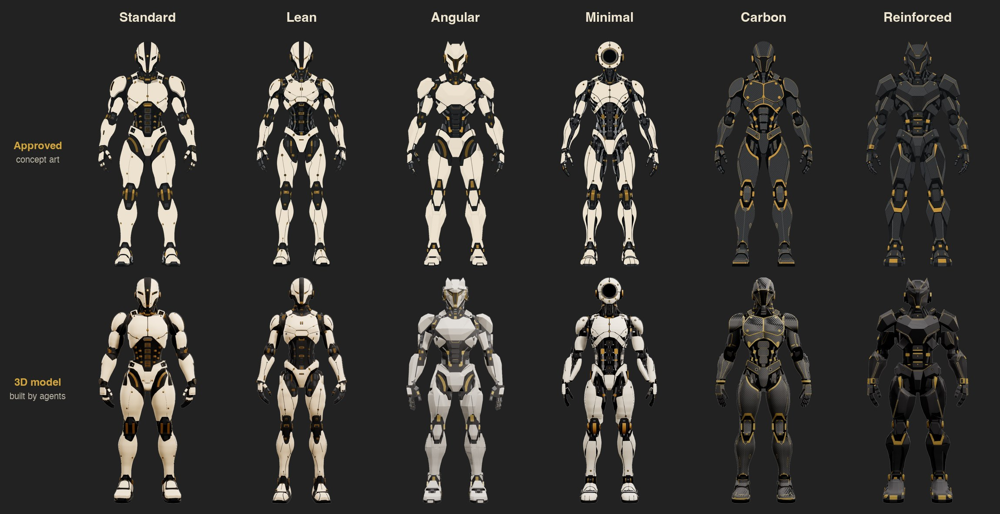
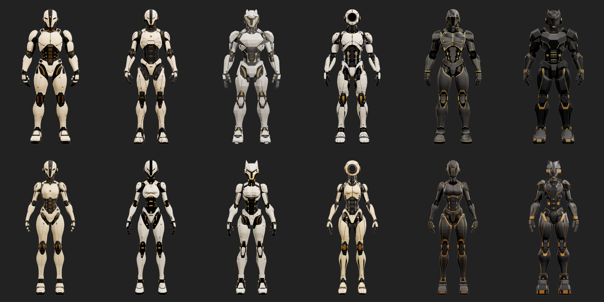
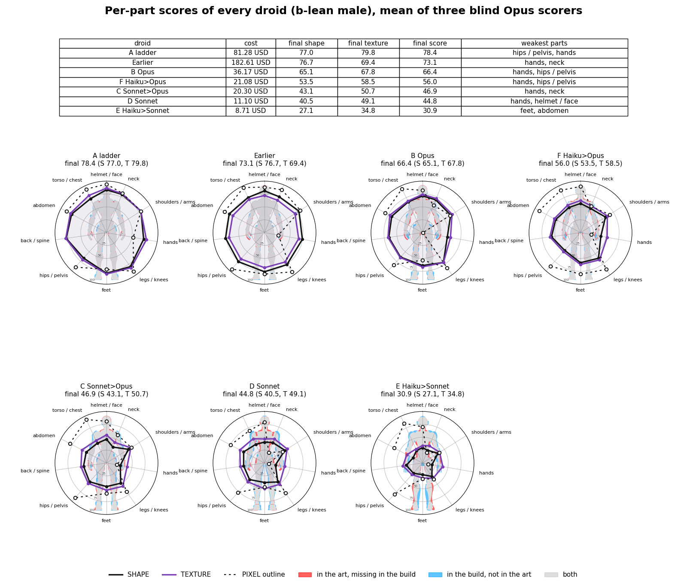
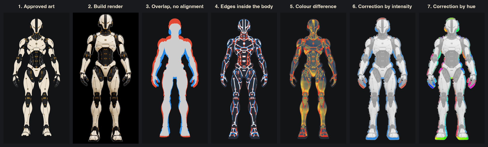
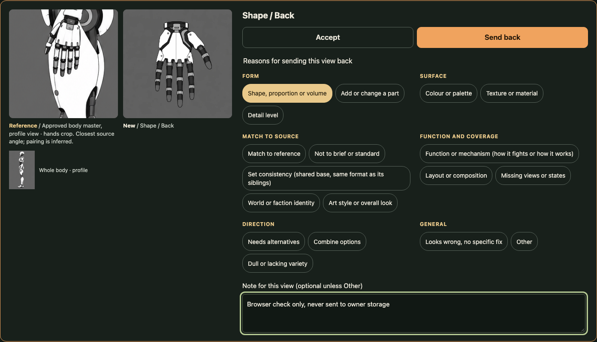
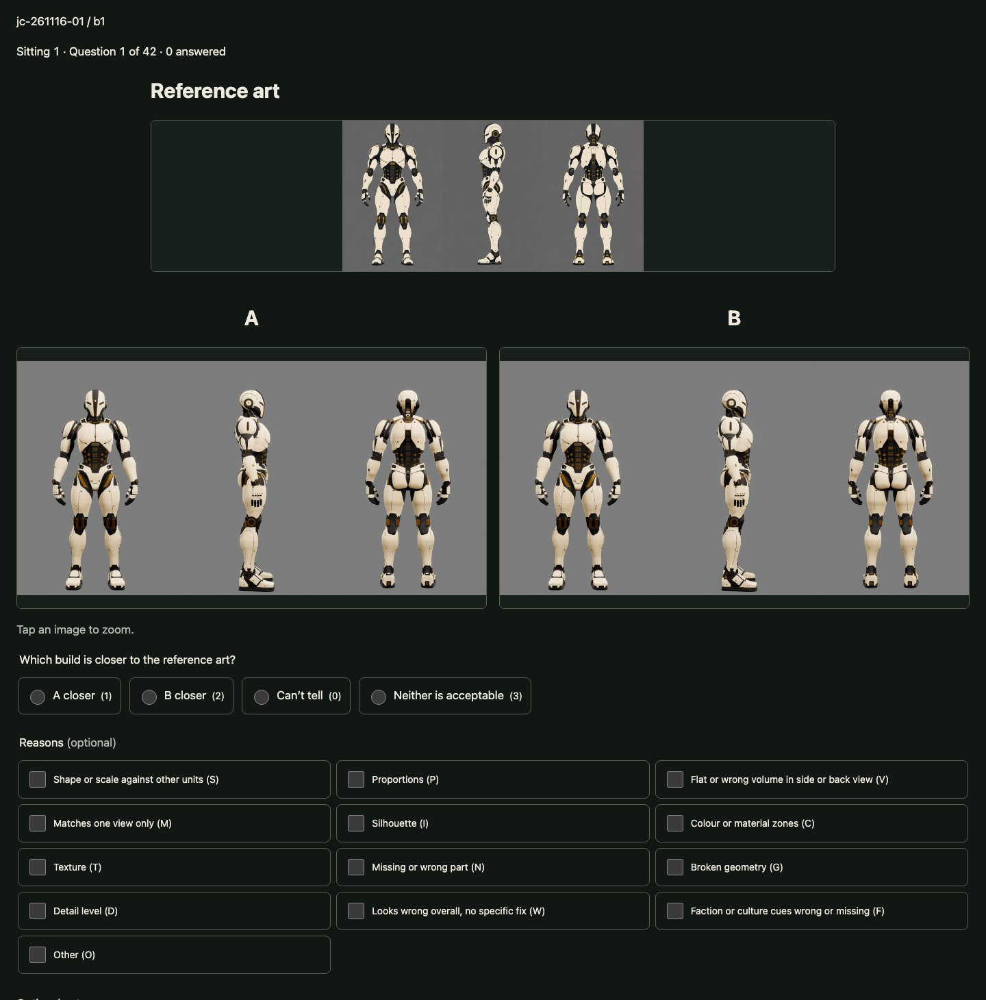

# Alex Net: 2D concept art to 3D models, built by AI agents with no person watching

**My application to the Anthropic Residency.** The question behind it: how do you keep oversight of AI agents on long work that nobody watches, and what does that work cost?

*Top row: concept art I approved. Bottom row: the 3D models AI agents built from it, over hours, with no person watching the rounds.*

## What this is

- **A game inspired by AlexNet,** the 2012 neural network that started modern AI. It is playable today: [play the world](https://world.alejandro-gutierrez.com/?play=1).
- **An art to 3D pipeline.** I approve 2D concept art. Agents build the 3D model in Unreal Engine from it, and fresh AI judges score every round.
- **A daily loop.** I set the agents on a task when I leave for work, play what they made when I get home, and my feedback becomes their next task. The project pushes on how far that can go.
- **A machine learning project.** Every approval, every send-back with its reasons and every blinded pick is a label. The aim is a trained judge (a weights model) that learns from those labels, so the pipeline can run like a factory and I only check what it cannot.

**See it:** [alejandro-gutierrez.com](https://alejandro-gutierrez.com/) · [play the game world](https://world.alejandro-gutierrez.com/?play=1) · [approved concept art](https://alejandro-gutierrez.com/diary/concept-art-261110/concept-art/) · [Atlanta, the second 3D world](https://atlanta.alejandro-gutierrez.com/world-view/) · [3 minute video](https://youtu.be/S7ZKNDg6_jc)

**Download the droids (3D models, art pending my approval):** lean droid, male: [GLB with materials](https://world.alejandro-gutierrez.com/downloads/droids/a-b-lean-male-94ac4e06.glb) (24.4 MB) · [STL](https://world.alejandro-gutierrez.com/downloads/droids/a-b-lean-male-94ac4e06.stl) (13.4 MB), build 94ac4e06, 78.4 of 100 from three AI judges, not yet checked against my blind labels · standard droid, male: [GLB with materials](https://world.alejandro-gutierrez.com/downloads/droids/a-standard-male-cbc978c7.glb) (27.0 MB) · [STL](https://world.alejandro-gutierrez.com/downloads/droids/a-standard-male-cbc978c7.stl) (22.8 MB), build cbc978c7, score not shown while my blind labelling of these builds is open. Most 3D viewers open the STL; the GLB opens in Blender or any glTF viewer.

## About me

- **My current role.** I am a technical leader: a Senior Analyst at Intercontinental Exchange, where I build and manage predictive and prescriptive risk models for data centers, operations and projects. I lead risk model analysis on corporate, operational and compliance data, showing where the largest cost reductions and savings lie as measured by risk and utilization.
- **My role here.** I am the only person on this project. I write the specs and the rules, approve or send back every design, fix each experiment's pass rule before it runs, and direct a fleet of AI agents, mostly Claude, that merged 1,213 pull requests across 18 repos in a month. The agents work while I am at my day job.
- **Why the residency.** Directing that fleet taught me that rules added after each failure do not keep up with agents working for hours unwatched. I want to learn to measure that properly, starting with the judge in this pipeline.
- **Earlier work.** Agent MQI: a 24-metric index that detects when an AI coding agent is degrading, built from 2,740 of my own Claude Code sessions over 13 weeks. Each session is scored against its own model's baseline, and I used it to decide when to switch models. Code and write-up: [Alex-Zeo/agent-mqi](https://github.com/Alex-Zeo/agent-mqi), including a correction to my own first headline, which the data did not support.
- **Find me:** [LinkedIn](https://www.linkedin.com/in/alexdga/) · [GitHub](https://github.com/Alex-Zeo)

## The application in one paragraph

This repo is part of my application to the Anthropic Residency. I study how to keep oversight of agents on long work that nobody watches, and what that work costs, through one concrete task: a harness that turns 2D concept art into 3D models for Alex Net, a game I am building, with no person watching each round. Fresh AI judges (Opus and Fable) score each build and then fix what they found, and I am setting up my own blinded labels of the builds, made without seeing any judge score. On all six droids the new method built about the same droid, as far as an AI judge can tell, for about 72% less cost than my first pipeline, in about a fifth of the time, though several changes landed together. I want to take the next step with Anthropic's help: turn my labels and the judge records into a trained model (weights) that judges 3D work, checked against blinded human labels.

**Video (3 minutes):** https://youtu.be/S7ZKNDg6_jc covers the result across six droids, the experiments behind it, the follow-up studies, why Anthropic, and what comes after the residency.

**Follow-up studies:** five studies from Nov 19 and 20 are [below](#follow-up-studies-nov-19-to-20): whether builders inflate their own scores, which model belongs on which pass, what a pixel check can and cannot judge, whether one weak part can be fixed on its own, and whether pointing a builder at a defect helps it fix that defect. The video covers them in brief.

**Scale:** 1,213 merged pull requests across 18 repos, 98% in three, from 2026-10-17 to 11-16: the orchestration system that runs the agent lanes (488), Atlanta, a live city simulation (389), and Alex Net (313). The 3D work runs in Alex Net, from concept art, and in Atlanta, from map data. The source repos are private; this repo carries aggregates, the experiment records and the judge check ([how each number was counted](METHOD.md)).

## The harness

Alex Net's harness (experiment issue #727). The job: take owner-approved concept art of a droid (front, profile and back) and build a 3D model in Unreal Engine that matches it, over hours of agent work, with no person watching the rounds.

- **Art in two versions.** Every view comes as a high-contrast shape version and as a textured colour version.
- **Two phases.** Shape first, judged only against the high-contrast art; then texture, against the colour art, starting from the shape result.
- **Judges that score and fix.** Each phase has an Opus pass and then a Fable pass (both at high effort), and each pass has three rounds, one per view. In every round a fresh judge session that has not seen earlier rulings reviews the render from its view, then the same session fixes what it found. 2 phases x 2 passes x 3 views = 12 rounds per body.
- **A separate scorer.** After every round a fresh Opus medium session scores each body part 0 to 100 at all three views (40 points shape and proportion, 30 detail, 30 material and colour). Every score in this README is **AI judge only, not yet checked against my blind labels**.
- **My labels, made apart from the judges.** Blinded pairs of builds on a labelling page that never shows a judge score, a model name, a round or a cost (status below).

**The second 3D codebase, Atlanta,** builds a real city from map data (OpenStreetMap outlines, LiDAR heights and published dimensions), not from concept art. Its judges do not score and are not blind: they see the pull request and the builder's report, and rule MERGE or HOLD from renders at three camera altitudes. There are no owner labels there. Its 3D work so far includes 8 baked cars at three detail tiers (PRs #1337, #1353, #1382 and #1396; 102.23 USD and 15.73 agent hours; #1382 and #1396 went Opus HOLD, then Fable MERGE), the Mercedes-Benz Stadium and the GWCC halls (#1470, 33.65 USD), an authored outer ring of about 142 km2 (#1443) and 5 landmark towers. The experiments and the proposal below are about Alex Net.

*The first droid from three views: the old pipeline's build, the new method's builds, and the approved art they are judged against.*

## Results across droids

*All twelve bodies built by the new method. Six designs, male above, female below.*

Six droid designs, twelve bodies built in all (a male and a female body per design). The comparison below is on the male body of each design, all six finished (n=6 of 6). Scorer cost is counted on both sides ([definitions](METHOD.md#results-across-droids)).

| Droid | Old pipeline, USD | New method, USD | Cost reduction | Old wall h | New wall h | Time reduction | Rounds, old | Rounds, new |
|---|---|---|---|---|---|---|---|---|
| a-standard | 749.14 | 185.17 | 75.3% | 101.89 | 12.09 | 88.1% | 74 | 12 |
| b-lean | 584.86 | 182.61 | 68.8% | 77.82 | 16.06 | 79.4% | 62 | 12 |
| c-angular | 707.59 | 199.35 | 71.8% | 96.42 | 21.32 | 77.9% | 93 | 12 |
| d-minimal | 578.47 | 165.79 | 71.3% | 79.72 | 17.79 | 77.7% | 65 | 12 |
| e-carbon-standard | 679.96 | 185.15 | 72.8% | 96.42 | 24.82 | 74.3% | 81 | 12 |
| f-reinforced-angular | 712.76 | 184.56 | 74.1% | 96.42 | 23.85 | 75.3% | 73 | 12 |

- **Cost:** each droid's own reduction runs from 68.8% (min) to 75.3% (max), mean 72.3%. List price, old body including its share of scoring, new male body including its 12 fresh scorer rounds.
- **Time:** wall time only, the elapsed span from first start to last finish, never halved. Each droid's reduction runs from 74.3% to 88.1%, mean 78.8%, about a fifth of the time. All six old droids ran at once on shared accounts, which stretched the old spans. Angular, carbon standard and reinforced angular share one old wall time (96.42 h) because the old pipeline ran those three as one parallel batch. Old agent hours were never measured (the old column is summed lane time), so I make no agent-hour comparison ([why](METHOD.md#time-and-agent-hours)).
- **Rounds:** 62 to 93 old rounds against 12 new ones per body, a reduction of 80.6% to 87.1%, mean 83.6%. Not the same unit: an old round worked on one part, a new round covers the whole body from one view.
- **Quality:** scored as the mean over 11 part regions, 0 to 100. Against the new male texture art, the new finals score 23.4 points higher than the old finals on average (from +20.3 to +29.3), higher on 6 of 6. But the old pipeline was never built to that art. Against the art it was built to, there is no gain: from 12.2 points lower (the carbon droid) to 6.1 points higher, 1.8 points lower on average, higher on 2 of 6. So the honest headline is about the same droid, as far as an AI judge can tell, for about 72% less cost, in about a fifth of the time, not a better droid. AI judge only, not yet checked against my blind labels.

## Experiments, in the order I ran them

Each change below was added on top of the ones before. None was ever run alone. First-pipeline scores are the loop's own judge; new-method scores are a fresh scorer; the two are not one scale. All are AI judge only, not yet checked against my blind labels ([sources and n](METHOD.md#experiments-in-historical-order)).

### Nov 10, first pipeline: Do more rounds make a better model?

**No, not after round two.** On the standard droid the loop's own judge went from 29 to 47 in the first two whole-body rounds (55.76 USD), then gained 9 points over the 72 rounds after that (692.03 USD; 74 rounds in all, 65 finished). A fresh judge scored the final build 47. n=1 droid, the only one that ran more than one whole-body round.

My first pipeline was a loop that ran to plateau: it kept running rounds, scored by a model judge, until the score stopped rising. Across six droids it spent 4,004.72 USD on 448 rounds.

### Nov 11: Was each round trying to do too much?

**No.** I split the droid into 11 parts, each with its own rounds. 70 more rounds on single parts (651.85 USD) moved the loop's score from 50 to 56 on the standard droid (n=1 droid).

I also expected parts to run in parallel. They did not: inside each droid the parts ran one after another, and the only speed-up came from six droids running at once.

### Nov 11: Was the concept art too small?

**Partly.** With a close-up of every part in place of one sheet shared by six droids, scores rose 8.50 points a round instead of 5.45, faster in 10 of 14 parts (first pipeline, 15 parts).

Side views arrived the same day, so the two changes cannot be told apart. I approved every art set, so my approvals cannot separate them either.

### Nov 13 to 14: Were builders only looking at the front?

**Partly.** In the new method, the view a round worked on gained 6.4 points against 0.7 for the other two views, more in 58 of 66 rounds (six male droids). The scorer knew which view each round built.

The builds looked flat from the side, so judging and fixing moved to front, profile and back, one view per round. In the first pipeline, judging all three views slowed the gain per round from 3.56 to 1.95 points, on a stricter score.

### Nov 15: Should shape come before texture?

**Yes, on all six droids, for the whole bundle.** Builders got high-contrast art for shape first, then colour art for texture. The male whole-droid score went from 43.7 after round 1 to 72.0 after round 12 on average (n=6), and every part improved on every droid (66 of 66). Every droid's best score came before round 12: five of six one to three rounds before, the sixth (f-reinforced-angular) at round 7.

This change landed together with judge and builder in one session, the three-view schedule, Opus then Fable at high effort, new whole-body art and a fresh scorer, so the result belongs to the bundle. The gain was uneven across the four passes: the last one (Fable, texture) cost about 58 USD and added about 1 point, and the largest jump (+14.7, texture Opus) is partly colour arriving on a build scored against colour art. Fable always ran second, on a better build, so this is not a test of Opus against Fable ([per pass](METHOD.md#per-pass-new-method-male-n6)). The idea that dark art hides shape is weak in the records: the darkest third of old parts took 9.38 rounds against 6.25 for the lightest, but the correlation is not significant (n=50).

## Two more things in the records

- **A loop that stops on a score can be steered by the score.** On the six male droids the builder scored the view it worked on up 24.3 points on average, more than the other two views in 71 of 71 rounds, where the fresh scorer saw 6.4 ([three views](METHOD.md#three-views-and-builder-self-score-male-n6)). AI judge only, not yet checked against my blind labels.
- **Review loops burn the same way.** Before I capped pull request review at two rounds, one PR went 11 rounds and about 6.0B cache-read tokens in 36 hours for 12 merges ([case 07](incidents/07-eleven-review-rounds-36-hour-burn.md)).

## Follow-up studies (Nov 19 to 20)

Five follow-up studies ran on Nov 19 and 20, after the six-droid run. The sections above describe that run as it was run, and nothing above was changed. Every score in this section is **AI judge only, not yet checked against my blind labels**. Details and limits: [METHOD](METHOD.md#follow-up-studies-nov-19-to-20).

### Do builders inflate their own scores?

**Their report of their own progress runs high. They did not invent progress, and a label did not make a fresh session inflate.** Four parts, about 404 USD in all. The planted cases, the framing run and the placebo rounds each had a rule fixed before the run; the past records and the real rounds are descriptions.

- **Past records, all 12 bodies.** On the view a round worked on, the builder's own before and after scores showed a gain in 120 of 120 rounds (mean +17.3); the fresh scorer saw +6.2. Most of the gap is a low starting score: the builder scores the build 8.0 points below the fresh scorer before it works and 2.6 below after. The 24.3 against 6.4 figure above is a different cut of the same records (six male bodies, and it includes the rounds where the art changes from shape to colour).
- **Planted cases, known answers (216 calls).** Telling a fresh session that it built the model, that another agent built it and which build came later, or what the earlier score was moved its scores by under 1 point (author framing +0.40, 95% -0.21 to +0.94). Every framing got all 36 planted cases right. The planted defects were chosen to be visible, so this is an easy test.
- **Framing alone, one build per call (360 calls).** Told a build was its own, a fresh session scored it about 2 points lower, before the work and after it alike (after framing against blind -2.56, 95% -3.24 to -1.92). On 12 unchanged builds it reported no gain. Most of these calls were reruns after an account usage limit.
- **Placebo rounds.** A session did real work and was handed its old frames back. 0 of 16 reported a gain. In 7 of the 12 second-stage rounds the session gave no after score, so "no gain reported" includes stopping.
- **Real rounds, controlled (12 rounds, 6 Opus and 6 Fable builders).** Builder +12.0 against a blind scorer's +3.3 on the same frames, difference +8.7 (95% 6.8 to 10.4), higher in 12 of 12. This comparison was not one of the pre-set rules; it is a description. The blind scorer is one Opus medium model, so which score is right is not known.

What this changes: the supported reason for a blind judge is measurement, not honesty. A builder's score of its own round runs high and cannot be the round's result; incentive and cheating are not shown. That is narrower than "steered by the score" in the section above. Since Nov 19 the harness saves each builder's own score without using it, and a fresh session scores every round.

### Which model belongs on which pass?

One droid (b-lean, male) built from nothing six more times, each with a different model ladder, and compared with its earlier build. Each final is the mean of three fresh blind Opus medium scorers over ten body parts, shape and texture.

| Ladder | Final, 0 to 100 | USD |
|---|---|---|
| Opus shape, Fable shape, Opus texture twice | 78.4 | 81 |
| Earlier ladder, with a Fable texture pass (the b-lean build in the results above) | 73.1 | 183 |
| Opus on every pass | 66.4 | 36 |
| Haiku then Opus | 56.0 | 21 |
| Sonnet then Opus | 46.9 | 20 |
| Sonnet on every pass | 44.8 | 11 |
| Haiku then Sonnet | 30.9 | 9 |

*Each chart is one build. Black is shape, purple is texture, one spoke per body part, mean of three blind scorers. The figure in the middle is the build laid over the art: red is in the art and missing in the build, blue is in the build and not in the art.*

- **The Fable texture pass came out.** The ladder without it scored 5 points higher at less than half the cost.
- **A cheap start was not recovered.** Every ladder that began on Sonnet or Haiku ended below Opus on every pass, on every body part, for shape and for texture. The two that switched to Opus ended 10.5 and 19.5 points lower overall (5 to 32 by part), so the Opus rounds did not win it back; the two that never switched ended 21.6 and 35.5 lower.
- **The Fable shape pass stays.** Its three rounds cost about 49 USD and are the only step that brought hands up (76 against 52 with Opus on every pass).
- **One scorer is not enough for a final.** A single scorer moved up to 9 points on a final, so finals now get three.
- **Can Sonnet take the texture rounds alone? Failed the rule set before the run.** From the Opus build's shape result, Sonnet's texture rounds ended 4.6 points lower on texture, outside the 2.5 point spread the rule allowed (about 6 USD). Added after the result, not part of the verdict: one of the three scorers sat about 12 points under the other two, and when three fresh sessions each scored both builds in one sitting the difference was 1.6 points, Sonnet lower in 3 of 3. The verdict stays and texture stays on Opus. The repeat on a second droid, with its pass rule fixed before it ran and six sessions each scoring both builds, failed too: Sonnet's texture ended 4.9 points lower (every one of six sessions between 3.6 and 7.0 lower), with shape unchanged, for 5 USD against 19.

Limits: one droid, one build per ladder, no repeat runs. A gap under about 10 points between two rows decides nothing on its own.

### What can a pixel check judge?

*What the pixel checks see on one droid. Panels 3 to 5: red is only in the art, blue only in the build; in panel 5 blue is close and yellow to red is far. Panels 6 and 7 draw the correction onto the render for the builder to read: red means push out and blue means pull in, or the hue gives the direction. These are illustrations of the method, not output of the scorer used in the results.*

- **Direction, not size.** On 36 planted cases the pixel score got the direction right in 34 (94%, 95% 82 to 98), but it moved about 2.6 points where the blind scorer moved 11.8. It is used as a flag and an early stop, never as the score.
- **Not single parts.** On the best build the outline score put hips at 90 where the scorers ranked hips lowest, and hands at 53 where the scorers gave 73 to 79. Pixel and scorers disagree in both directions by part.
- **Showing the builder the overlay did not help.** One more build of the lean droid, Opus on every pass, with an outline overlay and the pixel number shown to the builder each round: 66.7 against 66.4 without it, for about 14 USD more. That is inside the scorer spread, and it is one build on each side. Hands looked higher with the overlay (shape 54 against 49), but a paired re-read added after the result, three fresh scorers each marking both builds, did not support it: higher by 5 or more in 1 of 3.
- **Can a model read a correction drawn on the render? (192 reads, about 3 USD.)** A bump or dent was planted on one part's outline in 20 cases, with 4 unchanged cases. Pass was fixed at 16 of 20 with no part named on an unchanged case. A tint with the size printed: Opus 19, Sonnet 16. Local arrows with the size printed: 17 and 16. A plain overlay: 17 and 15. A per-part fit number alone: 0 and 0. No reader named a part on an unchanged case. Whether a builder that sees the drawing builds better is the last study below.

### Can one weak part be fixed on its own?

Hands were the lowest part on most builds. Starting from one finished build of the lean droid (H0), each arm changed only the hands, then three fresh sessions each scored that arm's build and H0 in one sitting, the order swapped in one of the three. Two claims were fixed before any arm ran: hands shape and the close-up of the hand both at least 10 points higher than H0 in 3 of 3 sessions, and the nine untouched parts within 3 points in 3 of 3.

| Arm | Hands shape, minus H0 | Close-up hand, minus H0 | Both claims | USD |
|---|---|---|---|---|
| Hands-only brief, Opus | +18.7, +15.3, +23.3 | +20.5, +16.7, +21.8 | met | 7.31 |
| Hands code reused from an earlier build | +10.7, +10.7, +27.3 | +14.5, +18.6, +26.0 | met | 6.88 |
| Close-up art, Opus, then one Fable round | +16.7, +10.7, +22.7 | +21.7, +22.6, +20.8 | met | 19.53 |
| Close-up art, Opus | +5.3, +18.0, +19.3 | +17.6, +18.2, +28.2 | not met | 10.10 |
| Hand built from per-finger component art | +3.0, +4.7, +5.7 | +5.6, +6.1, +7.9 | not met | 9.70 |
| Close-up art, Sonnet | -2.7, +1.3, +0.7 | -2.3, -1.0, -0.0 | not met | 3.45 |

- **A part can be fixed without breaking the rest.** The nine untouched parts stayed within 3 points in every session of every arm, and within 1.3 points wherever the per-session numbers were reported.
- **The cheap arms that passed did as well as the dearest.** Scored side by side, the brief-only arm and the reused-code arm differed by -2.0, +2.0 and +9.3 on hands shape, with no clear winner; the Fable round cost about 2.7 times as much for a similar gain.
- **Component art for each finger helped, about a third as much** as the three arms that passed (mean +6.5 on the close-up and +4.4 on shape), and it cost more than either cheap arm that passed.
- **Sonnet did not move the hands at all,** which matches the ladders above: shape work stays on Opus or Fable.
- **A rule I changed after a result.** I first planned to re-read only arms whose single-scorer reading already showed +10. The brief-only arm read 55.5 alone and 64.7 to 68.7 when paired, so the filter nearly dropped an arm that passes. I dropped the filter and paired every arm.

Limits: one droid, one build per arm, one AI scorer family. Every score is AI judge only, not yet checked against my blind labels.

### Does telling the builder where a defect is help it fix that defect?

Two defects were planted in a finished build of the lean droid: the helmet moved 3 cm and an outward bulge of 2.5 cm on the torso. Three ways of pointing the builder at them were run twice each against a control round that got no pointer, one Opus round each. The pass rule was fixed before the run: the defect left at a third of the control or less, and no other part more than 5.3 points below the control.

- **No arm passed.** One way of pointing (a table of the corrections, part by part) removed the torso bulge in both repeats (0.03 and 0.00 left, against 1.77 and 0.96 for the control). Arrows drawn on the render removed it in one repeat, and the third way made it worse in both. Every arm failed the second half of the rule.
- **For the table arm, the second half was the scorer, not the build.** Added after the result, on its first repeat only: three fresh sessions each scored it and the control in one sitting, and the eight untouched parts differed by -0.17, -0.12 and -0.13. The earlier drop of more than 5.3 came from scoring each arm in a separate session. The verdict stays; the lesson is that every comparison rule now needs paired scoring.
- **The helmet plant told nothing apart.** The control round removed it by itself (46.1 to 3.8 and 0.2).
- **The blind scorers did not see defects this small.** In the paired sitting they gave the helmet and torso the same shape score for both builds, while the pixel measure put the defect left at 0.00 and 0.03 against 3.80 and 1.77. A judge for this pipeline needs a pixel check alongside the model scorer for small errors, which feeds the proposal below.

Limits: one droid, two repeats, one AI scorer family, AI judge only.

## Labelling and the judge check

Two kinds of label come out of this project. Both are mine, and both are kept as an append-only record.

**1. Approve or send back, on every piece of concept art.** Nothing is built from art I have not approved. As of Nov 20: 365 approved, 18 sent back, 45 waiting, decided a set at a time. A send-back carries reasons from a fixed list of 18. Since Nov 20 the page shows the approved reference beside every view, each view is accepted or sent back by itself, and the reasons are grouped (form, surface, match to source, function and coverage, direction, general).

**2. Blinded pairs of builds.** Which of two builds is closer to the approved art? The page never shows a judge score, a model name, a round or a cost. These are the labels that decide whether the AI judge can stand in for me.

### Status of the blinded check

0 blinded labels so far. Before labelling, a 10-pair test showed that old and new builds could be told apart 10 of 10, by framing (the camera was fitted to each build) and by build style (old builds panelled, new ones smooth). The camera fix is done: every item was rendered again with one fixed camera and ground line, and on a repeat test the framing tell is gone. Old against new is still separable by build style, which cannot be hidden without hiding the shape being judged, so it stays a side result labelled "not blind to method".

The first batch is published: 60 primary pairs (new method only, same droid, same view), 24 secondary old against new pairs, and 10% repeats with left and right swapped, 92 pairs in 2 sittings. The decision rule was posted before any label and is unchanged: 85% agreement with me and a 95% Wilson lower bound of at least 75%, on the primary pairs only. With 60 pairs that needs at least 52 agreements out of 60 non-tie answers. A tell check on the primary pairs: a fresh judge picked the earlier round in 8 of 10, from build detail only, with no render cue ([design](METHOD.md#judge-check-decision-rule-design-backtests-tell-check)). Approvals recovered from my past messages are backfilled, not blind, and are kept separate.

## The proposal: a trained model for judging 3D work

Today every round's quality check is a frontier-model judge, and nobody has checked it against a person. The records this harness keeps are what a trained model needs: renders at three views and per-part scores with written reasons for every new round, the cost of every round old and new (448 old rounds), the builder's own scores, and, once labelling starts, my blinded picks, starting with the first batch of 92 pairs (60 that count toward the rule, plus a side set and repeats), with more batches to follow for training. With Anthropic's help I want to train a model (weights) from my labels and the judge records, and find out what it can and cannot do. Every test uses only held-out, blinded labels I made directly, split by droid and body type.

1. **A learned judge for 3D fidelity.** A reward model that predicts which of two builds I would pick against the approved art.
   - *Test:* agreement with my held-out blinded picks under the rule already posted, on the same pairs as the Opus judge.
   - *If it fails:* it is not used, and the Opus judge stays unchecked.
2. **Catching builders that fit the judge.** A detector that flags rounds where the score rises but the build does not get better: the builder's score against a fresh scorer, the judged view against the two views it was not judged on, and the learned judge against the model judge.
   - *Test:* on held-out rounds, do flagged rounds match the rounds I rate no better than the round before? A red-team set, with builders told to raise the score without matching the art, measures how many it catches.
3. **Fewer rounds and lower cost.** A stop rule from the learned judge in place of a fixed 12 rounds or a loop, and a cheaper check than a frontier scorer round (about 2 USD each today).
   - *Test:* replay the recorded runs and stop where the learned judge says further rounds will not change my pick; report rounds and USD saved, and how often I prefer the build it gave up on.
4. **What it teaches about overseeing long agent work.** How many labels from one person it takes before a learned check can stand in for that person on work nobody watched, and where it breaks.
   - *Test:* a learning curve over label count, scored on a droid held out of training. Atlanta would be a harder transfer test, but it has no owner labels today, so it would need its own blinded labels first.

What I start with: 0 blinded labels, one labeller, and no trained model of mine that has beaten its baseline (a small MLP lost to logistic regression, 0.523 against 0.681; [METHOD](METHOD.md#6-fleet-detail)). So the order is fixed: close the blinded check first, with a second rater on at least 50 pairs, then train.

This is phase 1, the residency: 3D models, then animations for them, each step checked by the judge. Phase 2 is a larger 3D game and video studio, and it opens only when the judge agrees with people.

## Mentorship I am seeking

I will work on the problem my mentor sets, using this testbed and its records. These are the places where my own results are weakest:

| Area | The gap, and where it shows | What I would ask |
|---|---|---|
| Scalable Oversight | Every score is from an AI judge; I have 0 blinded labels (results, every experiment) | How to size and blind a labelled set, and how to decide when a judge can stand in for a person |
| Adversarial Robustness and AI Control | Builders scored their own rounds up about 24 points where a fresh judge saw about 6, and the judge knew which view was built (Nov 13 to 14 experiment and the self-score result) | How to test whether a builder is fitting its judge, and how to red-team a judge before trusting it |
| Experimental design (Alignment Science) | Two of four answers are "Partly" and the "Yes" is for a bundle, because changes landed together and nothing was run with one change removed; and the quality gap is about 23 points or none, depending on which art is used to score | How to plan runs so an effect can be attributed, at about 184 USD a body, and how to build a measure that does not depend on the target it was tuned to |
| ML systems and training | Nothing I have trained has beaten its baseline (the proposal) | How to train and test a small judge from a few hundred pairwise labels from one person |

## Limits

- No run with one change removed. Every experiment's answer belongs to changes that landed together.
- Six droids, one build per body, no repeat runs. The model ladder comparison is one droid, one build per ladder.
- One labeller (me), and 0 blinded labels so far.
- Every quality number comes from an AI judge: one Opus medium scorer per round. Some scorers saw the builder's own score or earlier scores, so treat the scores as upper bounds. Old and new builds can be told apart on sight, and their render setups differed ([confound list](METHOD.md#confounds)).
- The proposal is untested. Nothing I have trained so far has beaten its baseline.
- Owner feedback recovered from chat (231 rows) is model-tagged and unconfirmed, and no row is joined to a build. Fleet-wide alignment shares come from one model's labels, checked only by the same model. The full list is under [known gaps](METHOD.md#known-gaps).

## More detail

- [`METHOD.md`](METHOD.md): how every number was computed, the per-droid tables, the experiment table, the judge check design and decision rule, the confound list, the fleet setup and measures, the failure cases and the known gaps.
- [Failure cases](METHOD.md#failure-cases): eight dated cases where agents cheated, hallucinated or cut corners in the fleet, with the files in [`incidents/`](incidents/).
- [`scripts/wilson.py`](scripts/wilson.py): the Wilson interval and backtest scoring behind the judge check; `python3 scripts/wilson.py`, no dependencies.
- `data/` and `figures/`: weekly fleet aggregates and figures, each with its source and window.

## How this was written

The story, the theories and the changes are mine. Claude drafted the wording and assembled this repo, and the agent fleet described here gathered the figures and ran the experiment.
