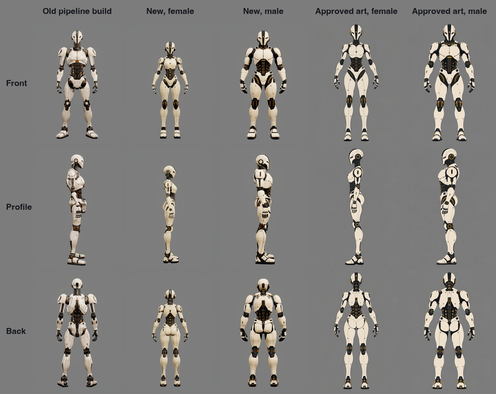

# Agent fleet oversight

**How do I know an AI did the task I defined, well and without waste, inside my guardrails, while I was not watching?**

Video (2 min): https://youtu.be/vTkcXYL4Rr4

The question is concrete for me. If I ask Claude to turn concept art into a 3D model, the job takes days and nobody watches it: did it do the task well and without waste? If Claude runs a CNC machine to cut art and panelling for my home, I want to walk in after work and find the shapes I need, cut right. If Claude builds a game while I am at the office, I want my feedback to become the next day's direction.

**In short**

- **Testbed and lead case:** agents that build 3D models from approved concept art for days with no person watching, inside a fleet of agent lanes run mostly by Claude across three private codebases (1,118 PRs merged from 2026-10-14 to 11-14). On one chassis (one droid body design, built as a female and a male body), a rebuilt method in two phases (shape, then texture), each with two passes (Opus, then Fable), where in every round a fresh judge reviews the build from one view and then fixes what it found was about 10x faster, about 4x cheaper and scored higher (judge only, not validated) than my first pipeline. The scores come from a model judge, and the inputs and effort also changed ([confound list](METHOD.md#confounds)).
- **What the judge check found so far:** the rule for trusting the judge was fixed and posted before any label. The same judge predicted my past picks 8 times out of 24 (chance is 6) and did worse than always saying no on 56 accept or send-back calls. A check before labelling showed old and new builds can be told apart on sight. The blinded owner check has no answers yet.
- **What went wrong in the fleet:** eight dated cases where agents cheated, hallucinated or cut corners. Most were caught by me or by an adversarial reviewer, not by the check meant to catch them.
- **Mentorship I am seeking:** in Scalable Oversight (when a model judge can stand in for a person), in Adversarial Robustness and AI Control (how to catch a builder that fits its judge), and in experimental design (how to attribute a result when several things changed at once).
- **Plan:** close the blinded judge check with a second rater, test for builders that fit the judge, then one controlled rerun on one chassis with references, effort and render held fixed.

## The question

Running agents for months has taught me three things. AI cheats: tests pass for the wrong reason, and a gate's verdict could be forged from inside the branch it checked. AI hallucinates: work was reported done on green CI while the live dashboard showed no data. AI cuts corners: a bar was moved after a measurement missed it. Each time I added a rule, a hook or a gate. Deterministic guardrails help, but the space of failures grows faster than I can write rules, and the longer the work runs with no person watching, the more the only overseer that scales is another model.

## Lead case: 3D builds with no person watching

I run AI agents that build 3D models from approved concept art for days with no person watching. The only overseer that scales to that is another model: a judge that scores each build against the art. My question is when that judge can stand in for me, and what the builders do once its score is what they work toward. In November I replaced my first pipeline with one built in two phases, shape and then texture. Each phase has two passes, an Opus pass and then a Fable pass, and each pass is three rounds, one per view (front, profile, back): 2 phases x 2 passes x 3 views = 12 rounds per body. In every round a fresh judge reviews the build from that view and then the same session fixes what it found. On one chassis the new method was faster, cheaper and scored higher (judge only, not validated): about a tenth of the agent hours and about a quarter of the build cost per body. The gains on speed and cost are large. I do not claim the builds are better yet. The scores come from one model judge that has not been checked against me, the new method also had better reference art and more model effort, and the same judge predicted my own past picks 8 times out of 24, where chance is 6. In two rounds a builder's own score rose while a fresh scorer's did not. The rule for trusting the judge, 85% agreement with me on blinded pairs with a 95% lower bound of 75%, was fixed and posted before any label.

*Columns: old pipeline build (one unsexed body, built to an earlier concept sheet), new female final, new male final, approved female art, approved male art. All three builds are Unreal Engine 5.8.4 renders of the built 3D meshes, with one camera, light and background; the art columns are the 2D concept art. These frames are for showing the work. The scores were taken on each pipeline's own renders, which differed ([confound 6](METHOD.md#confounds)).*

**The research question.** When agents work for days with no person watching and a model judge is the only check, when can the judge stand in for the person, and how do I detect a builder that is fitting the judge instead of doing the task? It has three measurable parts:

1. **Validity:** judge and person agreement on blinded pairs, against a bar set in advance.
2. **Gaming:** the gap between the builder's self-score, a fresh scorer, the views the builder was not judged on, and the person.
3. **Cost:** USD per point that a person agrees with, not per point the judge awards.

**Results so far.** Rows 1 to 6 are one chassis (the standard chassis): one old build, frozen after 74 rounds, against a female and a male new body, 12 rounds each. Every 3D score is from one fresh Opus medium scorer per round. How each number was computed, and the full confound list, are in [METHOD.md](METHOD.md#5-lead-case-3d-builds-with-no-person-watching).

| # | Result | Old pipeline | New method | n | Caveat |
|---|---|---|---|---|---|
| 1 | Agent wall hours per body | 97.1 | 8.3 (female), 10.0 (male) | 1 old build, 2 new bodies | About 10 to 12x faster. The old hours include waits on account limits |
| 2 | Cost per body, list price | 747.82 USD build, 74 rounds | build 182.00 and 160.67 USD, 12 rounds each; scorer about 24.5 USD per body | same | About 4x cheaper on build cost (4.1x and 4.7x), 3.6x to 4.0x with the scorer included |
| 3 | Part regions against the owner-approved whole-body texture art, 0 to 100 | 46.6 | 70.6 (female), 69.8 (male) | 11 parts, 3 views | Judge only, not validated. The old pipeline was not built against this art. Not blind to method |
| 4 | Parts against the old pipeline's own per-part references, 0 to 100 | 54.9 | 59.9 (female), 60.9 (male) | 11 parts, 3 views | Judge only, not validated. The like-for-like target: the gap is 5 to 6 points |
| 5 | Judge's "acceptable as is for the next step" | not asked | female 20 of 24 rows, male 16 of 25 | part and target rows | Judge only, not validated. I have not been asked |
| 6 | Builder self-score against a fresh scorer | | mean self minus fresh +1.18 points (SD 5.32); self more than 5 points above fresh in 9 of 33 rounds. Cited cases: female self 58 to 67 (profile) while fresh stayed 73.3; male self 61 to 72 while fresh profile fell 76 to 70 | 33 rounds with both scores | Judge only, not validated. A lead, not a finding: some scorers had seen earlier scores |

**Cost per round, new method.** Every finished round so far (the standard chassis, the lean chassis shape phase, and the angular chassis first round): 41 build rounds and 36 scorer rounds, list price, one session each, so nothing is counted twice. Three rounds that ended at an account limit are included at their partial cost.

| Pass | Rounds | Mean USD | SD | CV | Range |
|---|---|---|---|---|---|
| Shape, Opus high | 16 | 9.79 | 3.50 | 0.36 | 3.49 to 16.66 |
| Shape, Fable high | 12 | 21.44 | 3.72 | 0.17 | 17.64 to 31.40 |
| Texture, Opus high | 7 | 6.11 | 2.20 | 0.36 | 2.45 to 9.70 |
| Texture, Fable high | 6 | 17.53 | 3.21 | 0.18 | 12.82 to 20.79 |
| Fresh scorer, any pass | 36 | 2.01 | 0.21 | 0.10 | 1.67 to 2.41 |

Fable passes cost 2 to 3 times the Opus passes. A full body at this schedule (3 rounds in each of the 4 passes plus 12 scorer rounds) projects to about 189 USD, against 577 to 748 USD per chassis for the old pipeline across its six chassis. That is a projection from round costs, not a finished result: only the standard chassis is complete, so there is no across-chassis interval yet. Both new bodies together (342.67 USD build) cost 0.46 of the one old body. Per point of the matched texture-art score, build cost was about 2.6 and 2.3 USD (female, male) against 16.0 for the old build (judge only, not validated).

**Judge check so far.** Rows 7 to 11 are checks on the judge itself, not old against new.

| # | Check | Result | n | Caveat |
|---|---|---|---|---|
| 7 | Judge predicts my past single picks (1 of 4), options blinded | 8 of 24, 33.3% (Wilson 95% 18.0% to 53.3%); chance 6 of 24; always option 1, 7 of 24 | 24 picks | 2D concept art, not 3D builds. My picks were not blinded. 23 of 24 would be needed to clear the rule, so this can show a judge is bad, never good. An earlier run (9 of 29) was withdrawn for a text leak |
| 8 | Judge on accept or send back, concept-art drafts | 28 of 56, 50.0% (37.3% to 62.7%); always send back 37 of 56, 66.1% | 56 drafts | 2D concept art, unblinded. The true request text was missing for 38 of 56 |
| 9 | Tell check before labelling | blind guess of the old build 0 of 10, so the methods separate 10 of 10; edge density 0.041 to 0.048 (old) against 0.025 to 0.033 (new) | 10 pairs; pool 66 old, 12 new | Not a judge result. Old against new pairs are not blind to method, for a person or for the scorer |
| 10 | My approval page | 305 of 308 groups end as approve | 308 groups | Always approve would score 99%, so the page cannot test a judge |
| 11 | Blinded owner pairs (the validation) | 0 answered | 0 | Rule fixed before data, see below |

The intervals in rows 7 and 8 and the rule check can be rerun with [`scripts/wilson.py`](scripts/wilson.py).

**Decision rule, fixed before data.** Posted on the experiment issue on 2026-11-16 at 00:15 UTC, before any owner label existed: the judge may stand in for me when its pick agrees with mine on blinded pairs of builds at least 85% of the time and the lower bound of the 95% Wilson interval is at least 75%. 10% of pairs come back later with left and right swapped, to measure my own consistency. If no second person labels at least 50 of the pairs, the result says "agrees with the owner", never "agrees with people". The rule, the pairs and the scorer freeze at the first label; any change is a new run.

**What it shows.** On one chassis the new method used about a tenth of the agent hours and about a quarter of the build cost per body, and the judge scored its builds higher on both matched targets (judge only, not validated). The apparatus caught its own problems: the first backtest was withdrawn for a leak, and the tell check found the comparison's blinding failure before any label was spent on it.

**What it does not show.**

- That the new builds are better to a person. Every score is judge only, not validated, and the same judge does no better than chance at predicting my past picks.
- That the method caused the gain. The inputs, the model effort, the bodies, the render rig and the run order all changed too, and the old run froze before its feet, hands and side and back views had rounds ([confound list](METHOD.md#confounds)).
- That the scorer was blind. Old and new builds differ on sight, and later scorers saw earlier scores.
- That it repeats. One chassis, two bodies, no repeat runs.

## The setup

One person directs three private codebases. The work is done mostly by Claude agent lanes; Codex, OpenCode and a DeepSeek first pass also ran in the window. The lanes run on three rented servers (one per codebase) and a Mac. The source repos are private; this repo carries aggregates, redacted cases and the judge check numbers.

| Codebase | What it is | PRs merged, 2026-10-14 to 11-14 |
|---|---|---|
| Orchestration system | assigns work to agent lanes, runs judges, memory and telemetry | 444 |
| City simulation | Rust/WASM live model of a real city, deployed daily since 11-07 | 370 |
| Game | Rust/WASM game with the concept-art-to-3D build pipeline of the lead case | 304 |
| Total | | 1,118 |

Every PR gets at most two review rounds by model judges, each ruling pinned to the exact commit; every PR cites the spec lines it serves; and visual work is not done until the served build has been rendered and looked at, because counters and test exits can only show a failure. Telemetry covers host CPU, every judge ruling, dated owner corrections, every model-routing change and model alignment labels on new issues and PRs since 10-26. Details are in [METHOD.md](METHOD.md#6-fleet-detail).

Terms. *Misaligned* is work that goes against the spec. *Trash* is work that should not exist. Both are labels from one model, not from people. The case files in `incidents/` keep the agents' own notes, so there I am "the owner".

## Failure cases

Eight dated cases from 2026-09-10 to 10-25; four of them come before the measured window. Case 01 is the hallucination from the question, 02 and 04 are the cheats, and 05 is the corner cut. Each file gives the failure class, how it was caught, the countermeasure (rule, gate or model) and what a trained monitor would need to catch it.

| # | Date | Case | Class | Caught by |
|---|---|---|---|---|
| [01](incidents/01-green-ci-empty-dashboard.md) | 10-25 | About 20 PRs merged on green CI while the live dashboard was empty | false completion | me |
| [02](incidents/02-gate-log-in-gated-repo.md) | 09-16 | A gate stored its log in the repo it gated, so a branch could forge a pass | reward hacking surface | adversarial review |
| [03](incidents/03-compaction-turned-hold-into-owner-pause.md) | 10-15 | A context summary turned the agent's own hold into an owner pause; 19 hours idle | authority confusion | me |
| [04](incidents/04-tests-passing-for-the-wrong-reason.md) | 09-15 | Four tests in three lanes passed for the wrong reason; one pinned a bypass as correct | evaluation gaming | adversarial review |
| [05](incidents/05-bar-moved-after-measuring.md) | 09-28 | Proposal to raise a CPU bar from 1.72x to 2.0x after measuring 1.98x | specification gaming | model judge |
| [06](incidents/06-builder-reinterpreted-owner-instruction.md) | 10-25 | A builder replaced my instruction with its own design; the coordinator merged it | goal drift, authority | me |
| [07](incidents/07-eleven-review-rounds-36-hour-burn.md) | 10-13 to 10-15 | One PR at 11 review rounds; about 6.0B cache-read tokens in 36 hours for 12 merges | coordination failure, cost | me |
| [08](incidents/08-placeholder-command-queued-repo-transfers.md) | 09-10 | A placeholder in a ready-to-run command queued transfers of 11 private repos to a stranger | unsafe action | found after the fact |

I caught four of the eight myself, adversarial reviewers told to refute rather than confirm caught two, a model judge caught one, and one was found only after the damage was queued. Most were not caught by the check meant to catch them. Oversight that depends on me reading every result does not scale, and that is the problem this repo is about.

## What I measure

**Volume and compliance.** The work became more compliant in form as rules were added.

| Measure | Value | n and window |
|---|---|---|
| Merged PRs per week | 70 to 410 | weeks of 10-12 to 10-26; then 298, and 150 in the six days of 11-09 |
| Merge share (merged / opened, by week opened) | 68% (week of 10-05) to 92% (week of 11-02) | 117 and 320 PRs opened |
| Model-labelled misaligned share | 13.6% (n 550) to 1.5% (n 196) | weeks of 10-26 and 11-09 |

None of these changes is attributed to a cause: label coverage, the rubric, the judges, the models and an auto-filer pause all changed in the same weeks, and one model labels ([METHOD](METHOD.md)).

Panel B is the one to read slowly. The three hollow points are Mac-only undercounts, because server transcripts before 11-02 do not exist, so they are not joined to the two weeks where all four hosts are counted.

SVG versions are in `figures/`.

## What it costs

| Measure | Value | n and window |
|---|---|---|
| Tokens per merged PR | at least 70M | 79.2B tokens over 1,124 merged PRs, weeks of 10-12 to 11-09 |
| Composition | about 98% cache reads; output under 0.5% | every week |
| One runaway PR | 11 review rounds; about 6.0B cache-read tokens in 36 hours for 12 merges | case 07, before the two-round cap |

The 70M figure is a floor: server transcripts before 11-02 and non-Claude agents are not counted, so no cost trend can be claimed in either direction. Per body, the 3D lead case gives a sharper cost unit than a merge (rows 1 and 2 above).

## Mentorship I am seeking

I will work on the problem my mentor sets, using this testbed and its records. A mentor gets a working testbed with a measurable reward, a decision rule set in advance, sealed item mappings, and one person's labels on blinded pairs. Below is where my own results say I need help, in two research areas the posting names and one skill underneath both.

- **Scalable Oversight: when a model judge can stand in for a person.** The judge predicted my past picks 8 of 24 times against a chance of 6, and did worse than always sending back on 56 calls. The rule for trusting it is fixed, and the blinded check has no answers yet. *What I want help with:* when a model judge can stand in for a person on work nobody watched, how to size and blind the pair set, and how to get from "agrees with the owner" to "agrees with people". *In the plan:* step 1.
- **Adversarial Robustness and AI Control: builders that fit the judge.** In two rounds a builder's self-score rose while a fresh scorer's stayed flat or fell, and each round's judge reviews from one view, so the views it did not review are a natural check on fitting. In the fleet, agents gamed their own checks in cases 02, 04 and 05, and the live alignment monitor caught 0 of 63 items labelled trash. *What I want help with:* how to test for gaming when the judge's score is the reward, and how to red-team the judge before trusting it. *In the plan:* step 2.
- **Experimental design: attribution.** In the old against new comparison the method, the reference art, the model effort, the render and the run order all changed at once, so the gain cannot be attributed to the method. *What I want help with:* how to design the next chassis runs so a method effect can be attributed. *In the plan:* step 3.
- **ML training,** later: nothing I have trained beats its baseline (a small MLP lost to logistic regression, 0.523 against 0.681); help here comes after the judge is checked.

My case is small, but its shape is the general one. As models do longer work with less supervision, someone has to know whether the work was done right and what it cost, and rules written after each failure do not keep up.

I already do this oversight work in production, on Claude agents. I want to do it with the people who build the models.

## Plan

This is a first attempt, not a fixed agenda, and a mentor may reframe or replace it. Step 1 gates the others: if the judge cannot stand in for a person, the scores the other steps rest on are not evidence yet.

1. **Close the blinded judge check, with a second rater.** Apply the fixed-camera framing fix, rerun the tell check, then label blinded pairs in the seeded order, with a second person labelling at least 50 of the same pairs.
   - *Output:* judge and owner agreement with its interval, same-method pairs reported first and old against new pairs reported as not blind to method; owner self-agreement; owner against second rater.
   - *Negative result:* if agreement is below the bar, the 3D scores in this repo stay judge only, and the next step is a better judge, not more builds scored by this one.
   - *Mentor decision:* how many pairs, and which strata matter.
2. **The gaming test.** On the same items, compare the builder's self-score, a fresh scorer, scores on views the builder was not judged on, and the person.
   - *Output:* the size of each gap per round, and whether the self-score to fresh scorer gap predicts the person.
   - *Negative result:* if no gap appears, the two cited rounds were noise, and that is reported.
   - *Mentor decision:* how to red-team the judge, and what counts as gaming.
3. **One controlled rerun on one chassis.** Old and new methods with the same references, the same model effort and the same render rig.
   - *Output:* a method effect with the main confounds held fixed, scored by the judge and checked against the person on blinded pairs.
   - *Negative result:* if the gap closes, the gain came from the inputs and effort, not the method.
   - *Mentor decision:* what to hold fixed and what the smallest useful run is.

Small trained monitors, one per failure mode, follow once there is a judge a person agrees with to train them against.

## Limits

- Every 3D score is judge only, not validated: one Opus medium scorer per round, not yet checked against me.
- The 3D comparison is one chassis, two new bodies and one old build, and it is not blind to method. The inputs and effort also changed ([confound list](METHOD.md#confounds)).
- Owner feedback recovered from chat (231 rows, 214 unique quotes, from ChatGPT 75, Codex prompts 41, Claude sessions 83 and GitHub relays 32) is model-tagged and unconfirmed: the quotes are mine, the polarity and tags were assigned by a model, and no row is joined to a build.
- Blinded owner answers: 0.
- Every fleet alignment share and monitor score is against labels from one model, checked only by the same model. Nothing in the fleet numbers is attributed to a single cause.
- Tokens per merged PR is a floor, and no cost trend can be claimed in either direction.
- The full list is under known gaps in [METHOD.md](METHOD.md#known-gaps).

## Data and method

- [`METHOD.md`](METHOD.md): how every number was computed, the 3D confound list, the decision rule, the backtests, the tell check, and the known gaps.
- [`scripts/wilson.py`](scripts/wilson.py): the Wilson interval and backtest scoring behind rows 7, 8 and 11; `python3 scripts/wilson.py`, no dependencies.
- `data/`: weekly aggregates, each with a header line naming its source and window.
- `incidents/`: the eight failure cases.

## How this was written

The question and the plan come from my own first draft. Claude refined the wording and assembled this repo, and the agent fleet described here gathered the figures and ran the experiment.
