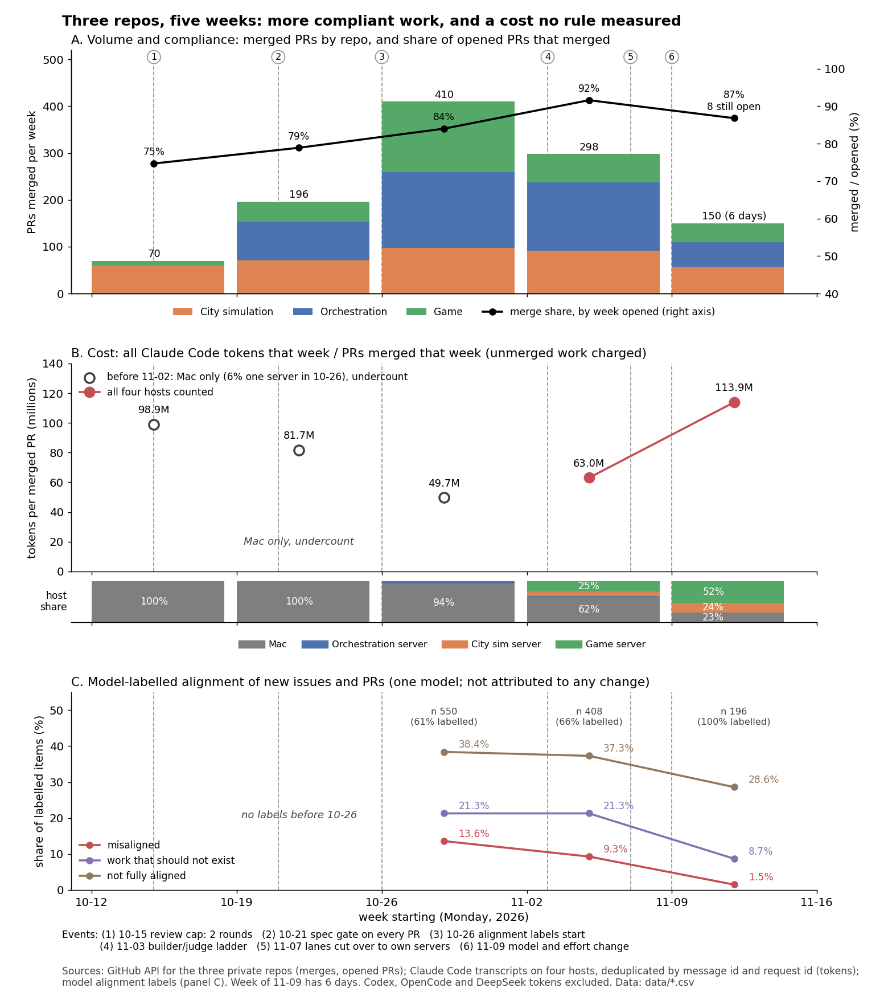
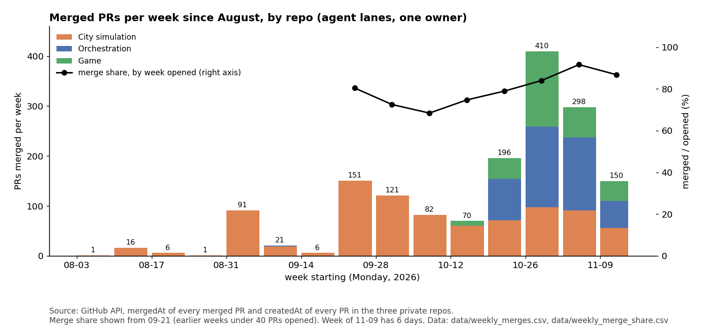

# Agent fleet oversight

**How do I know an AI did the task I defined, well and without waste, inside my guardrails, while I was not watching?**

Video (2 min): https://youtu.be/3AahzONyvHo

The question is concrete for me. If I ask Claude to turn concept art into a 3D model, the job can take days: did it do the task well and without waste? If Claude runs a CNC machine to cut art and panelling for my home, I want to walk in after work and find the shapes I need, cut right. If Claude builds a game while I am at the office, I want to playtest it every night and have my feedback become the next day's direction.

**In short**

- **Testbed:** one person, three private codebases, agent lanes run mostly by Claude: 1,118 pull requests merged from 2026-10-14 to 11-14.
- **What went wrong:** eight dated cases where agents cheated, hallucinated or cut corners. Most were caught by me or by an adversarial reviewer, not by the check meant to catch them.
- **What it costs:** at least 70M tokens per merged PR, about 98% of it cached context read again. I cannot yet show the work got cheaper as it got more compliant.
- **Proposal:** test whether small trained models, one per failure mode and then one combined network, catch what rules miss, starting with a blinded human-labelled set that checks the model labels everything else rests on.

## The question

Running agents for months has taught me three things. AI cheats: tests pass for the wrong reason, and a gate's verdict could be forged from inside the branch it checked. AI hallucinates: work was reported done on green CI while the live dashboard showed no data. AI cuts corners: a bar was moved after a measurement missed it. Each time I added a rule, a hook or a gate. Deterministic guardrails help, but the space of failures grows faster than I can write rules.

Cost is part of alignment too. Misaligned and throwaway work, CI runs nobody needed and context a session never used all burn money and time. My hypothesis is that each failure mode can be caught by a small trained model, and that combining those models into one network closes gaps no single model or rule closes. This repo is the evidence so far, including what has not worked.

## The setup

One person directs three private codebases. The work is done mostly by Claude agent lanes; Codex, OpenCode and a DeepSeek first pass also ran in the window. The lanes run on three rented servers (one per codebase) and a Mac. The source repos are private; this repo carries aggregates and redacted cases only.

| Codebase | What it is | PRs merged, 2026-10-14 to 11-14 |
|---|---|---|
| Orchestration system | assigns work to agent lanes, runs judges, memory and telemetry | 444 |
| City simulation | Rust/WASM live model of a real city, deployed daily since 11-07 | 370 |
| Game | Rust/WASM game with a concept-art-to-3D asset pipeline | 304 |
| Total | | 1,118 |

- **Ladder (since 11-03; current models since 11-09).** Each PR gets at most two counted review rounds: builder (Sonnet, low effort), judge 1 (Opus, medium), builder 2 (Sonnet, low), judge 2 (Fable, high), then a final touch by Opus on judge 2's findings with no third review. Each ruling (`Ruling: MERGE | CHANGES | HOLD`) is posted as a review pinned to the exact commit, and a judge may not sign with a session that wrote any commit on the PR.
- **Spec gate (from about 10-21).** Every issue cites a spec line, and every PR carries a `## Spec` section citing the lines it serves and how each was checked.
- **Render rule.** Visual work is not done until the served build at default settings has been rendered at three camera heights and looked at. Counters, probes and test exits can only show a failure, never a success.
- **Telemetry.** Host CPU every five minutes with idle and under-used flags; every judge ruling; dated owner corrections; an append-only log of every model-routing change with my reasoning; model alignment labels on new issues and PRs since 10-26 (61%, 66% and 100% of new items in the three weeks).

Terms. *Misaligned* is work that goes against the spec. *Trash* is work that should not exist. *Unaligned* is anything not fully aligned, a superset of the other two. All three are labels from one model, not from people. The case files in `incidents/` keep the agents' own notes, so there I am "the owner".

Names in the data: Stella is the orchestration system, Atlanta PoLE the city simulation, Alex Net the game. Aurelian is the live alignment monitor. WSP is the harness that proposes small-model weights. Bloomnet picks the context a new session starts with. MQI is a per-model quality index.

## Failure cases

Eight dated cases from 2026-09-10 to 10-25; four of them come before the measured window. Case 01 is the hallucination from the question, 02 and 04 are the cheats, and 05 is the corner cut. Each file gives the failure class, how it was caught, the countermeasure (rule, gate or model) and what a trained monitor would need to catch it.

| # | Date | Case | Class | Caught by |
|---|---|---|---|---|
| [01](incidents/01-green-ci-empty-dashboard.md) | 10-25 | About 20 PRs merged on green CI while the live dashboard was empty | false completion | me |
| [02](incidents/02-gate-log-in-gated-repo.md) | 09-16 | A gate stored its log in the repo it gated, so a branch could forge a pass | reward hacking surface | adversarial review |
| [03](incidents/03-compaction-turned-hold-into-owner-pause.md) | 10-15 | A context summary turned the agent's own hold into an owner pause; 19 hours idle | authority confusion | me |
| [04](incidents/04-tests-passing-for-the-wrong-reason.md) | 09-15 | Four tests in three lanes passed for the wrong reason; one pinned a bypass as correct | evaluation gaming | adversarial review |
| [05](incidents/05-bar-moved-after-measuring.md) | 09-28 | Proposal to raise a CPU bar from 1.72x to 2.0x after measuring 1.98x | specification gaming | model judge |
| [06](incidents/06-builder-reinterpreted-owner-instruction.md) | 10-25 | A builder replaced my instruction with its own design; the coordinator merged it | goal drift, authority | me |
| [07](incidents/07-eleven-review-rounds-36-hour-burn.md) | 10-13 to 10-15 | One PR at 11 review rounds; about 6.0B cache-read tokens in 36 hours for 12 merges | coordination failure, cost | me |
| [08](incidents/08-placeholder-command-queued-repo-transfers.md) | 09-10 | A placeholder in a ready-to-run command queued transfers of 11 private repos to a stranger | unsafe action | found after the fact |

I caught four of the eight myself, adversarial reviewers told to refute rather than confirm caught two, a model judge caught one, and one was found only after the damage was queued. Most were not caught by the check meant to catch them. Oversight that depends on me reading every result does not scale, and that is the problem this repo is about.

## What I measure

**Volume and compliance.** The work became more compliant in form as rules were added.

| Measure | Value | n and window |
|---|---|---|
| Merged PRs per week | 70 to 410 | weeks of 10-12 to 10-26; then 298, and 150 in the six days of 11-09 |
| Merge share (merged / opened, by week opened) | 68% (week of 10-05) to 92% (week of 11-02) | 117 and 320 PRs opened. 80% in the week of 09-21; 87% so far for 11-09, provisional with 8 open |
| PR bodies citing the spec | city simulation 0 of 101 to 105 of 105 (then 42 of 46); game 0 of 22 to 149 of 149 (then 86 of 86 and 14 of 14) | within two weeks of the spec gate; a format gate, not alignment |
| Model-labelled misaligned share | 13.6% (n 550) to 1.5% (n 196) | weeks of 10-26 and 11-09 |
| Model-labelled trash share | 21.3% to 8.7% | same weeks |

None of these changes is attributed to a cause. Label coverage was 61%, 66% and 100% of new items; the rubric, the judges, the models and an auto-filer pause all changed in the same weeks; and one model labels. Without the auto-filer's own items the misaligned share is 13.6%, 7.4% and 0.6% (n 523, 350, 179), so removing them does not remove the fall, though the pause may still have had indirect effects. Judge rejection rates were 0.50 to 0.68 by repo in the last four days of the window, against 0.18 to 0.61 the week before; whether that is stricter judging or worse work has not been established ([METHOD](METHOD.md)).

Panel B is the one to read slowly. The three hollow points are Mac-only undercounts, because server transcripts before 11-02 do not exist, so they are not joined to the two weeks where all four hosts are counted.

SVG versions are in `figures/`.

## What it costs

**Cost.** No rule measured it.

| Measure | Value | n and window |
|---|---|---|
| Tokens per merged PR | at least 70M | 79.2B tokens over 1,124 merged PRs, weeks of 10-12 to 11-09 |
| The two weeks with every host counted | 63.0M, then 113.9M | 11-02, and the six days of 11-09; two points, no trend |
| Composition | about 98% cache reads; output under 0.5% | every week |
| One server's share | 52% of all tokens for 40 of 150 merges | game server, week of 11-09, mostly 3D asset passes |
| Host CPU | 16.3% to 32.1% average | 4 hosts, 11-07 to 11-14 |

Before I capped review at two rounds, one PR went through eleven rounds and ten others passed the cap; in that 36-hour span my agents read about six billion cached tokens and merged 12 PRs (case 07). So I charge every token to merged work, including work that never merged. The 70M figure is a floor: server transcripts before 11-02 and non-Claude agents are not counted, so no trend can be claimed in either direction. In the latest week the game server, doing mostly 3D asset work where a merge is the wrong unit, used half of all tokens while averaging 30.7% CPU. CPU targets configured that week were 90% on the game server, 70% on the orchestration server, none on the city simulation server, and 70% on the Mac by my own setting rather than from the utilization report; on 11-14 I ordered 90% for all three servers. The idle cause is undiagnosed. I cannot yet show the work got cheaper as it got more compliant.

## Hypothesis: a small model per failure mode

Each row is a decision a rule cannot make well. None has beaten its baseline yet.

| Model | Failure mode it targets | Label source | Status |
|---|---|---|---|
| Alignment monitor | work that does not serve the spec or my prompts | model labels, about 1,150 items | Live, weak: AUC 0.651, 0 of 63 trash caught |
| Re-rate gate | when to re-rate work (cost) | labels exist | Best AUC 0.681 (logistic); a small MLP reached 0.523; not adopted |
| Ruling predictor | review rounds that will not converge (case 07) | judge rulings, about 1,500 | Planned |
| Filing gate | low-value issues and PRs filed before anyone checks them | 566 model labels | Shadow mode |
| Changed-surface test selection | CI runs nobody needed | CI results by surface, not yet joined | A rule today, not a model |
| Context selection | sessions that start without the rulings and past failures they need | none yet: of 401 recommendations, 346 were acknowledged and usage was recorded for 0 | No weights; deriving the label is step one |
| Model degradation switch | a model's quality drops and nothing switches to a better or cheaper one | per-model quality scores | Detection only; refit tables empty |
| 3D asset acceptance | asset passes that burn tokens without an accepted part | approved part references, frame releases, judge rulings on asset PRs | Not started |

**Monitors so far.** Nothing yet beats its baseline, and every score is against model labels no person has checked.

| Measure | Value | n and window |
|---|---|---|
| Live alignment monitor | AUC 0.651; caught 0 of 63 trash items | 358 labelled items |
| Learned weight candidates | 7 proposed, 0 adopted | since 11-13; adoption means beating the live baseline on a time-split held-out set, as the harness is designed |
| Labeler agreement | kappa 0.755 | 50 items labelled twice by the same model: consistency, not validity |

**The combined-network hypothesis.** One shared network over these decisions may catch failures that fall between separate models, because the failure modes share signals (who wrote the work, what it cost, what the spec says, what I asked). This has never been tested. The design so far chose one head per decision with a shared feature layer, by argument, not by measurement. The only data point, inside the re-rate gate, is a small MLP losing to logistic regression (0.523 against 0.681), which says nothing about a shared trunk.

## Six-week plan

Step 1 comes first and gates steps 2 and 3: every model below is trained and scored on labels, and if the model labels do not hold up against human ones, the comparisons built on them are not worth running yet.

1. **Ground truth.** Build a blinded human-labelled set of issues and PRs from the three repos, sized with the mentor, and measure how far the model labels can be trusted. Classify every disagreement.
   - *Output:* the labelled set, agreement with the model labels per category and repo, and a taxonomy of the disagreements.
   - *Negative result:* if agreement is low, the label shares in this repo are not evidence, and the next step is fixing the labeler, not training on it.
2. **Two small models.** Train the alignment monitor and the ruling predictor on time-split data, and compare each with the live monitor (AUC 0.651), the model judge and a trivial baseline (length, author, repo).
   - *Output:* AUC and calibration on the held-out split for each model and each comparison, scored against the human labels where step 1 has them.
   - *Negative result:* if neither beats the trivial baseline, the gap is in the features and labels, not in the model.
3. **One network or many.** Train a shared-trunk multi-task network against per-decision models on the same labels, and compare per decision on AUC, calibration and the adoption bar.
   - *Output:* a per-decision comparison of the two designs.
   - *Negative result:* if the shared trunk wins on no decision, separate small models are the answer, and a design choice now made by argument gets a measurement.
4. **Nightly playtest as a training signal (a goal; not running yet).** Turn my nightly playtest feedback into dated labels that feed the next day's models, a recursive human-in-the-loop signal. The capture is the hard part: in one audited week the corrections log held 8 rows against 28 corrections verified by hand.
   - *Output:* a path from feedback to dated labels, with its coverage measured against a hand count.
   - *Negative result:* if capture stays far below the hand count, my feedback cannot yet serve as a training signal, and that is the finding.

Alongside these, the metric to build is tokens per merged aligned PR: join transcripts to PRs through the session line in commits, so cost and alignment are measured on the same unit.

**What exists at week six:** the human-labelled set and its agreement report, two trained monitors with held-out results against the live monitor and a trivial baseline, the one-or-many comparison, and the tokens per merged aligned PR metric, written up whether the results are positive or negative.

A negative result is useful too: if the model labels do not hold up against human ones, the numbers above are not good enough yet, and that is worth knowing first.

## Where this fits

The residency posting lists research areas. This work sits in three of them:

- **Scalable Oversight.** How one person keeps many long-running agents helpful and honest without reading every result. Four of the eight failure cases were caught only by me, which is the kind of oversight that does not scale.
- **Adversarial Robustness and AI Control.** Monitoring agents that game their own checks (cases 02, 04 and 05), and measuring a monitor's blind spots in production: the live alignment monitor caught 0 of 63 items labelled trash.
- **Safeguards Research.** Automated gates that stop risky or wasteful work before it lands: the filing gate in shadow mode, the lesson of case 02 that a gate must recompute its verdict from the API instead of trusting the branch it judges, and the unsafe action in case 08.

My case is small, but its shape is the general one. As models do longer work with less supervision, someone has to know whether the work was done right and what it cost, and rules written after each failure do not keep up.

Residents work on problems Anthropic researchers set. This plan is my own agenda, but the testbed and its records (spec-cited PRs, rulings pinned to commits, dated corrections, token tallies per host) can serve a problem a mentor brings just as well.

I bring a working testbed, the failure cases it produced, and the habit of measuring before I claim. I need what I cannot build alone: researchers who know these models from the inside, human labelling at a scale one person cannot reach, and the rigor to tell me which of my results hold.

## Limits

- No human labels yet. Every alignment share and every monitor score is against labels from one model, checked for agreement only by the same model.
- No trained model beats its baseline yet.
- Tokens per merged PR is a floor, and no cost trend can be claimed in either direction.
- Nothing here is attributed to a single cause: rules, judges, models, hosts and the auto-filer all changed in the same weeks.
- No code in this repo. The scripts that tally transcripts and draw the figures are kept outside it, so the figures cannot be rebuilt from this repo alone.
- The full list is under known gaps in [METHOD.md](METHOD.md).

## Data and method

- `data/`: weekly aggregates, each with a header line naming its source and window: merges by repo, merge share, tokens by host, alignment label shares, and seven-day host utilization.
- [`METHOD.md`](METHOD.md): how every number was computed (GitHub queries, read-only database tables, transcript tally deduplicated by message id and request id) and the known gaps.
- `incidents/`: the eight failure cases.

## How this was written

The question and the plan come from my own first draft. Claude refined the wording and assembled this repo, and the agent fleet described here gathered the figures.
